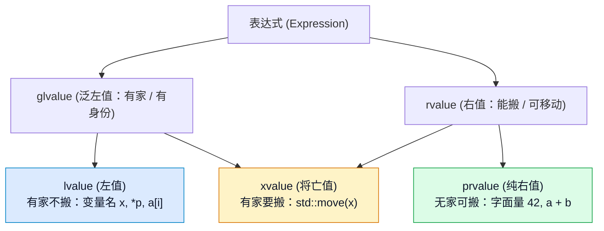

# C++ 值类别（Value Categories）与左值右值深度解析

很多人在学 C++11 的左值（lvalue）、纯右值（prvalue）、将亡值（xvalue）、右值引用（`T&&`）和 `std::move` 时，会被一堆绕口令一样的术语搞得晕头转向。

请先彻底忘掉那些英文缩写，用下面这个**“房子与搬家”的物理直觉**，30 秒就能看穿 C++ 设计这套规则的唯一底层目的。

---

## 0. 30 秒物理直觉：为什么要分左值、纯右值、将亡值？

想象你在写软光栅渲染器时，手里有一个占了 **10MB 内存的 `Image`（纹理贴图）对象**。
当你把一个对象传给另一个变量或函数时，C++ 编译器只关心一个跟“钱（性能）”息息相关的问题：
> **“这 10MB 的内存数据，我能不能直接白嫖（把指针抢过来），还是要老老实实花 10MB 重新复印（深拷贝）一份？”**

为了回答这个问题，C++ 把代码里所有的表达式分成了三种“房产状态”：

### 1. 左值（lvalue）= “别人正在住的房子”（所有有名字的变量）
- **比如**：变量 `img1`、`vec`、`*ptr`、`arr[0]`。
- **直觉**：既然它有名字 `img1`，说明主人下一行代码还要接着用它。你能把人家正在住的房子里的家具（10MB 内存指针）偷偷搬空吗？**绝对不行！**
- **结论**：遇到左值，默认**不能抢，只能老老实实深拷贝（复印一份）**。

### 2. 纯右值（prvalue）= “刚出厂、没写主人名字的临时快递”（所有没名字的临时结果）
- **比如**：函数返回的临时结果 `loadImage("a.png")`、算术结果 `v1 + v2`、字面量 `42`。
- **直觉**：它连个变量名都没有！这行代码（分号 `;`）一结束，它就会被系统当垃圾原地销毁。既然它下一秒就要死了，里面那 10MB 数据与其先花 10MB 复印一份再把原件炸掉，不如**直接白嫖接管（移动构造 / 原地构造）**！
- **结论**：遇到纯右值，**放心大胆直接白嫖（0 拷贝开销）**！

### 3. 将亡值（xvalue）= “主人亲自贴了【拆迁废品，随便搬】条子的旧房子”
- **比如**：**`std::move(img1)`**。
- **直觉**：`img1` 本来是有名字的左值（别人都不敢动它）。但程序员自己心里清楚：“我后面再也不用 `img1` 了”，于是调用 `std::move(img1)` —— **它的唯一作用，就是在 `img1` 脑门上贴一张“可拆迁（将亡值）”的条子**！
- **结论**：贴了条子后，原本有名字的左值就变成了**将亡值**，别人就可以像对待临时快递一样，合法地把它里面的 10MB 内存指针直接抢走了！

---

## 1. 一张表 + 一句口诀搞定三类值

记住这句话：**C++11 以后不要再用“等号左边/右边”区分左右值**，而是看两个维度：**① 有没有家（身份/名字）**、**② 能不能搬（当作临时源抢走资源）**。

> **终极口诀：左值有家不搬，将亡有家要搬，纯右无家可搬。**

| 值类别 | 中文 | 有家（有身份/地址）？ | 能搬（可抢走资源）？ | 直觉比喻 | 最常见代码长相 |
| :--- | :--- | :---: | :---: | :--- | :--- |
| **lvalue** | **左值** | **是** | **否** | 正在住人的房子 | 有名字的变量 `x`、`*p`、`a[i]`、`++x`、返回左值引用 `T&` 的函数（如 `a += b`） |
| **xvalue** | **将亡值** | **是** | **是** | 贴了拆迁条的旧房 | `std::move(x)`、返回右值引用 `T&&` 的函数 |
| **prvalue** | **纯右值** | **否** | **是** | 没名字的临时快递 | 字面量 `42`、`x + 1`、`x++`、匿名临时对象 `vec3f{}`、返回非引用 `T` 的函数（如 `a + b`） |

它们的组合统称也很简单：
- **泛左值（glvalue）= 左值 + 将亡值**（只要“有家”的都算）。
- **右值（rvalue）= 将亡值 + 纯右值**（只要“能搬”的都算，所以**拆迁队 `T&&` 专门接这两类**）。



---

## 2. 三种引用符号：装修队、参观团与拆迁队

看懂了上面的“房子比喻”，C++ 里的三种引用符号瞬间就明白了：

| 引用写法 | 角色比喻 | 能绑定谁？ | 工程里用来干什么？ |
| :--- | :--- | :--- | :--- |
| **`T&`**<br>（普通左值引用） | **装修队** | **只能绑左值**（有家不搬的房） | 进去帮主人**修改**原对象的数据。不能绑临时快递（改一个马上销毁的临时量毫无意义）。 |
| **`const T&`**<br>（常量左值引用） | **只读参观团** | **万能通吃**（左值、纯右值、将亡值都能绑） | 发誓“只看不摸（只读）”。平时写函数传参（如 `dot(const vec3f& a, const vec3f& b)`）最常用，既避免拷贝，又能同时接受变量和临时表达式 `v1 + v2`。 |
| **`T&&`**<br>（右值引用） | **拆迁搬家队** | **只能绑右值**（纯右值 + 将亡值） | **专门用来写移动构造函数/移动赋值函数**！一旦绑上，就进屋把人家的堆内存指针（如 `mBuffer`）夺过来据为己有，避免深拷贝！ |

代码示例一看就懂：

```cpp
int x = 1;

int& r1 = x;             // ✅ 装修队进了有名字的房子 x
// int& r2 = 1;          // ❌ 报错：1 是临时量，装修队不给没名字的临时快递装修

const int& r3 = 1;       // ✅ 参观团只看不改，连临时量 1 都能绑（还会顺便给临时量续命）

int&& r4 = 1;            // ✅ 拆迁队接管没名字的临时量（纯右值）
int&& r5 = std::move(x); // ✅ 拆迁队接管贴了拆迁条的旧房（将亡值）
// int&& r6 = x;         // ❌ 报错：x 正在住人也没贴拆迁条，拆迁队严禁强拆左值！
```

---

## 3. 核心避坑指南（实战 99% 的坑都在这三条）

### 坑 1：右值引用变量本身，一旦有了名字就是左值！

```cpp
void process(Image& img)  { std::cout << "普通左值：只读或修改，不敢搬空\n"; }
void process(Image&& img) { std::cout << "右值拆迁：直接抢走 10MB 内存指针！\n"; }

void relay(Image&& r) {
    // 请问：在这里写 process(r)，会调用上面哪一个？
    process(r);            // ⚠️ 调用的是第一个 process(Image&)！因为 r 有名字，r 是左值！
    process(std::move(r)); // ✅ 调用第二个 process(Image&&)！必须再贴一次拆迁条！
}
```
- **为什么 C++ 要把有名字的 `r` 算作左值？**
  因为拆迁队把东西搬进仓库，并**给仓库起了个名字叫 `r`**。如果在 `relay` 函数里有好几行代码都要用 `r`，要是 `r` 还是右值，第一行代码刚用了一下 `r`，它的内存就被别人抢空了，第二行代码再用 `r` 就崩了！
- **铁律**：**只要有名字的变量，写出来全都是左值！** 想继续往下转交拆迁权，必须写 `std::move(r)`。

### 坑 2：`std::move(x)` 本身不移动任何东西！
- 很多人以为调用了 `std::move(x)`，内存就在这一行被搬走了。
- **真相**：`std::move(x)` 底层只是一句强制类型转换 `static_cast<T&&>(x)`（前面说的**“贴拆迁条”**），它生成 **0 条运行期 CPU 指令**。
- **真正动手搬内存的**，是后面紧接着被触发的**移动构造函数 `T(T&&)`** 或 **移动赋值函数 `operator=(T&&)`**。

### 坑 3：函数返回局部变量时，既不能返回 `T&` / `T&&`，也别写 `return std::move(result);`！

```cpp
// ❌ 致命错误 1：返回局部变量的右值引用 T&&（悬空引用，必崩！）
Matrix44&& badCreate() {
    Matrix44 result;
    return std::move(result); // 灾难！T&& 也是引用（借地址），result 出门就死，借出的是死人墓地！
}

// ✅ 唯一正确写法：直接按值返回 T，直接 return 局部变量名！
Matrix44 createMatrix() {
    Matrix44 result;
    // ...
    return result;             // ✅ 正确：触发 NRVO 原地构造，0 拷贝、0 移动！
    // return std::move(result); // ❌ 负优化：强行废掉 NRVO，多出一次 64 字节复制！
}
```
- **核心铁律**：
  - **无论是 `T&` 还是 `T&&`，只要带了 `&`，本质全都是“借出一个已有对象的内存地址”，绝对不拥有对象！**
  - 函数内部新建的对象出门即死，所以**产生新对象永远只能按值返回 `T`**（直接 `return result;`，编译器会通过 NRVO 直接在调用方内存原地盖房）。
  - **那什么时候才会写返回 `T&&` 的函数？** 平时写业务/图形学代码 **99.9% 的场景下根本不该返回 `T&&`**！只有标准库作者在写 `std::move`、`std::forward` 这种“纯粹帮调用者给外面还活着的对象贴拆迁条”的工具函数时才会返回 `T&&`。

---

## 4. 进阶附录：语法边缘细节备查（初学可跳过，面试/深究时再看）

> [!NOTE]
> 以下内容属于 C++ 标准中的角落规则，平时写软光栅业务代码极少直接碰到，不用强行记忆，需要时翻阅即可。

### 附录 A：为什么前置 `++x` 是左值，后置 `x++` 是纯右值？
- **前置 `++x`**：直接把变量 `x` 自己在内存里加 1，然后把 `x` **原件自己（`T&`）**递出来，所以是**左值**（你可以写 `++++x;`）。
- **后置 `x++`**：语义要求“先返回加之前的旧值，再把 `x` 加 1”。为了返回旧值，它只能在内部先复印一份临时的旧值副本，再把原变量加 1，最后把那份**没名字的临时旧值副本（`T`）**端出来，所以是**纯右值**（你不能写 `x++++;`），而且后置 `x++` 比前置 `++x` 多一次临时对象拷贝开销。

### 附录 B：还有哪些容易猜错的左右值特例？
1. **字符串字面量 `"abc"` 是左值，不是纯右值！**
   - 虽然整数 `42`、浮点数 `3.14f` 都是纯右值，但 `"abc"` 的底层类型是 `const char[4]` 字符数组，编译后存放在程序全局只读数据段（`.rodata`）里，有固定内存地址（甚至可以取地址 `&"abc"`），所以它是**左值**。
2. **访问右值临时对象的成员变量 `(v1 + v2).x` 是将亡值（xvalue）！**
   - `v1 + v2` 是纯右值（没名字的临时快递）；但当你点出里面的 `.x` 时，它指代了那个临时快递盒里的具体部件（**有了身份**），同时整个快递盒马上要销毁（**可以搬走**），既有身份又可搬走，所以在标准里归为 **xvalue（将亡值）**。

### 附录 C：模板里的“万能引用（转发引用 `T&&`）”与 `std::forward`
在写通用模板时，你会看到 `T&&` 配合 `std::forward`：
```cpp
template<typename T>
void wrapper(T&& arg) {
    target(std::forward<T>(arg)); // 完美转发：传进来是左值就按左值转交，传进来是右值就按右值转交
}
```
- **注意甄别真假万能引用**：只有**当前函数正在发生独立类型推导**且**形式严格为无修饰的 `T&&`**（或 `auto&&`）时，它才是左右值通吃的“万能引用”。
- 如果加了 `const`（如 `const T&&`）、套了容器（如 `std::vector<T>&&`），或者 `T` 在外层类模板实例化时早就定死了（如 `std::vector<int>::push_back(int&&)`），那它就**只是普通的右值引用（拆迁队）**，不能绑左值。
- **引用折叠口诀**：**“有左则左（`&`），全右才右（`&&`）”**。

### 附录 D：`decltype` 推导口诀
```cpp
int x = 1;
decltype(x)            // int   —— 单纯写变量名：原来声明是什么类型就是什么类型
decltype((x))          // int&  —— 多套了一层括号变成“左值表达式”：左值表达式统一加 &
decltype(1)            // int   —— 纯右值表达式：不加引用
decltype(std::move(x)) // int&& —— 将亡值表达式：统一加 &&
```

### 附录 E：什么时候返回 `T&&` 才是合法的？（标准库底层写法）
如前所述，返回 `T&&` 的函数调用表达式本身是**将亡值（xvalue）**，它**不交出新对象，只是“借出一个可被移动的已有对象”**。因此仅在被借出的对象**在函数外部依然存活**时才合法：
1. **`std::move` 与 `std::forward` 的内部实现**（把调用者传进来的活对象强转为 `T&&` 借回去）：
   ```cpp
   template<class T>
   constexpr std::remove_reference_t<T>&& move(T&& t) noexcept {
       return static_cast<std::remove_reference_t<T>&&>(t);
   }
   ```
2. **右值限定的成员访问器（如 `std::optional<T>::value() &&`）**：当外层容器本身是马上要销毁的右值时，用 `T&& get() && { return std::move(member); }` 允许把容器内部的成员直接移动掏空出来。
- **工程口诀**：**产生新对象无脑返回 `T`；借用自身/成员返回 `T&`；日常业务代码几乎永不返回 `T&&`。**
