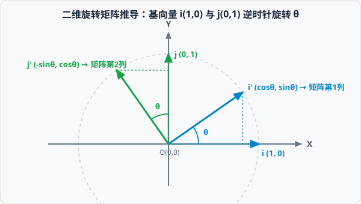

# 仿射变换起源与二维齐次坐标推导

在三维图形学与渲染管线中，所有复杂的空间运动（平移、旋转、缩放、剪切与透视投影）最终都统一表达为 $4 \times 4$ **矩阵与 4D 齐次坐标的乘法**。这种优雅统一的数学架构并非凭空产生，而是为了破解二维平面几何变换中遇到的“矩阵困局”。

本文档从最基础的几何直观出发，严密推导二维旋转矩阵，揭示平移变换无法用 $2 \times 2$ 矩阵表达的本质原因，并阐明齐次坐标如何通过升维艺术实现图形变换的大一统。

---

## 1. 线性变换与矩阵乘向量的几何直观

在二维笛卡尔坐标系中，空间中的任意一点可以用二维列向量表示：

$$
\mathbf{v} = \begin{bmatrix}
x \\
y
\end{bmatrix}
$$

当一个 $2 \times 2$ 矩阵左乘该向量时：

$$
\mathbf{v}' = M \mathbf{v} = \begin{bmatrix}
a & b \\
c & d
\end{bmatrix} \begin{bmatrix}
x \\
y
\end{bmatrix} = \begin{bmatrix}
ax + by \\
cx + dy
\end{bmatrix}
$$

从几何上看，矩阵乘法实际上定义了**原空间基向量的映射规则**。根据线性代数基底分解：

$$
\begin{bmatrix}
x \\
y
\end{bmatrix} = x \begin{bmatrix}
1 \\
0
\end{bmatrix} + y \begin{bmatrix}
0 \\
1
\end{bmatrix} = x \mathbf{i} + y \mathbf{j}
$$

$$
M \mathbf{v} = x (M \mathbf{i}) + y (M \mathbf{j}) = x \begin{bmatrix}
a \\
c
\end{bmatrix} + y \begin{bmatrix}
b \\
d
\end{bmatrix}
$$

- 矩阵的**第一列** $[a, c]^T$ ，就是 $X$ 轴基向量 $\mathbf{i}$ 变换后的新落点；
- 矩阵的**第二列** $[b, d]^T$ ，就是 $Y$ 轴基向量 $\mathbf{j}$ 变换后的新落点。

### 1.1 缩放变换（Scale）
若希望将图形在 $X$ 轴缩放 $s_x$ 倍，在 $Y$ 轴缩放 $s_y$ 倍：
- 原基向量 $\mathbf{i}(1, 0)$ 变为 $(s_x, 0)$ ；
- 原基向量 $\mathbf{j}(0, 1)$ 变为 $(0, s_y)$ 。

将两列拼接即可得到缩放矩阵：

$$
S = \begin{bmatrix}
s_x & 0 \\
0 & s_y
\end{bmatrix}, \quad \begin{bmatrix}
x' \\
y'
\end{bmatrix} = \begin{bmatrix}
s_x & 0 \\
0 & s_y
\end{bmatrix} \begin{bmatrix}
x \\
y
\end{bmatrix} = \begin{bmatrix}
s_x x \\
s_y y
\end{bmatrix}
$$

---

## 2. 待定系数法推导二维旋转矩阵

假设将平面上的点 $\mathbf{v}(x, y)$ 绕坐标原点逆时针旋转 $\theta$ 角，得到新坐标 $\mathbf{v}'(x', y')$ 。

我们可以设定未知的变换矩阵：

$$
R_\theta = \begin{bmatrix}
A & B \\
C & D
\end{bmatrix}
$$

利用基向量的运动轨迹求解这 4 个未知数：

### 步骤 1：代入基向量 $\mathbf{i}(1, 0)$
基向量 $\mathbf{i}$ 长度为 1，绕原点逆时针旋转 $\theta$ 角后，落在单位圆上：

$$
\mathbf{i}' = \begin{bmatrix}
\cos\theta \\
\sin\theta
\end{bmatrix}
$$

代入矩阵方程：

$$
\begin{bmatrix}
A & B \\
C & D
\end{bmatrix} \begin{bmatrix}
1 \\
0
\end{bmatrix} = \begin{bmatrix}
A \\
C
\end{bmatrix} = \begin{bmatrix}
\cos\theta \\
\sin\theta
\end{bmatrix} \implies A = \cos\theta, \quad C = \sin\theta
$$

### 步骤 2：代入基向量 $\mathbf{j}(0, 1)$
基向量 $\mathbf{j}$ 位于 $Y$ 轴正方向，逆时针旋转 $\theta$ 角后：

$$
\mathbf{j}' = \begin{bmatrix}
\cos(\theta + 90^\circ) \\
\sin(\theta + 90^\circ)
\end{bmatrix} = \begin{bmatrix}
-\sin\theta \\
\cos\theta
\end{bmatrix}
$$

代入矩阵方程：

$$
\begin{bmatrix}
A & B \\
C & D
\end{bmatrix} \begin{bmatrix}
0 \\
1
\end{bmatrix} = \begin{bmatrix}
B \\
D
\end{bmatrix} = \begin{bmatrix}
-\sin\theta \\
\cos\theta
\end{bmatrix} \implies B = -\sin\theta, \quad D = \cos\theta
$$

### 结论：二维标准旋转矩阵

$$
R_\theta = \begin{bmatrix}
\cos\theta & -\sin\theta \\
\sin\theta & \cos\theta
\end{bmatrix}
$$

任取一点 $(x, y)$ ，旋转后的坐标公式即为：

$$
\begin{cases}
x' = x \cos\theta - y \sin\theta \\
y' = x \sin\theta + y \cos\theta
\end{cases}
$$

---

## 3. 平移变换的“矩阵困局”

在完成了缩放与旋转之后，我们考察最常见的平移变换（Translation）：将点 $(x, y)$ 沿 $X$ 轴移动 $t_x$ ，沿 $Y$ 轴移动 $t_y$ ：

$$
\begin{cases}
x' = x + t_x \\
y' = y + t_y
\end{cases}
$$

### 困局本质：线性变换 vs 仿射变换
在线性代数中，**线性变换必须满足两条公理**：
1. **可加性**： $T(\mathbf{u} + \mathbf{v}) = T(\mathbf{u}) + T(\mathbf{v})$ ；
2. **齐次性（数乘性）**： $T(c \mathbf{u}) = c T(\mathbf{u})$ 。

由公理可知：**任何线性变换必然保持原点不动**，即 $T(\mathbf{0}) = \mathbf{0}$ 。
然而平移变换将原点 $(0, 0)$ 搬迁到了 $(t_x, t_y) \neq (0, 0)$ ，因此**平移不是线性变换**！

如果坚持使用 $2 \times 2$ 矩阵，我们永远无法找到一个常数矩阵 $M$ ，使得：

$$
\begin{bmatrix}
a & b \\
c & d
\end{bmatrix} \begin{bmatrix}
x \\
y
\end{bmatrix} = \begin{bmatrix}
x + t_x \\
y + t_y
\end{bmatrix}
$$

（当代入原点 $x=0, y=0$ 时，左侧恒为 $[0, 0]^T$ ，而右侧为 $[t_x, t_y]^T$ ，矛盾！）

平移不得不退化为向量加法：

$$
\mathbf{v}' = M \mathbf{v} + \mathbf{t}
$$

这就导致了**管线分裂**：复合旋转和缩放用矩阵乘法，平移却要单独用加法，不仅无法连续复合多个矩阵，且硬件无法使用统一的脉动阵列进行流水线加速。

---

## 4. 齐次坐标（Homogeneous Coordinates）的升维艺术

为了将“加法平移”收编进“矩阵乘法”的大一统框架中，图形学先驱引入了**齐次坐标**：**通过升维（增加一个维度 $w$ ），将原本在低维空间中的非线性平移变换，转换为高维空间中的线性剪切（Shear）变换。**

### 4.1 点与向量的齐次表示
在齐次坐标系中，我们为二维坐标补充第 3 个分量 $w$ ：
- **三维齐次点（Point）**：令 $w = 1$ ，表示为 $\mathbf{P} = [x, y, 1]^T$
- **三维齐次向量（Vector）**：令 $w = 0$ ，表示为 $\mathbf{v} = [x, y, 0]^T$

$$
\mathbf{P} = \begin{bmatrix}
x \\
y \\
1
\end{bmatrix}, \qquad
\mathbf{v} = \begin{bmatrix}
x \\
y \\
0
\end{bmatrix}
$$

### 4.2 构造 $3 \times 3$ 平移矩阵
利用新增的第 3 列作为“蓄水池”，构造如下矩阵：

$$
T(t_x, t_y) = \begin{bmatrix}
1 & 0 & t_x \\
0 & 1 & t_y \\
0 & 0 & 1
\end{bmatrix}
$$

#### 验证 1：点乘以平移矩阵

$$
\begin{bmatrix}
1 & 0 & t_x \\
0 & 1 & t_y \\
0 & 0 & 1
\end{bmatrix} \begin{bmatrix}
x \\
y \\
1
\end{bmatrix} = \begin{bmatrix}
1 \cdot x + 0 \cdot y + t_x \cdot 1 \\
0 \cdot x + 1 \cdot y + t_y \cdot 1 \\
0 \cdot x + 0 \cdot y + 1 \cdot 1
\end{bmatrix} = \begin{bmatrix}
x + t_x \\
y + t_y \\
1
\end{bmatrix}
$$

- 坐标成功完成了平移；
- 第 3 分量仍保持为 1，表明变换后**依然是一个合法的空间点**！

#### 验证 2：向量乘以平移矩阵
空间中的向量表示“纯粹的方向与位移”，与起始位置无关，具有**平移不变性**。

$$
\begin{bmatrix}
1 & 0 & t_x \\
0 & 1 & t_y \\
0 & 0 & 1
\end{bmatrix} \begin{bmatrix}
v_x \\
v_y \\
0
\end{bmatrix} = \begin{bmatrix}
1 \cdot v_x + 0 \cdot v_y + t_x \cdot 0 \\
0 \cdot v_x + 1 \cdot v_y + t_y \cdot 0 \\
0 \cdot v_x + 0 \cdot v_y + 1 \cdot 0
\end{bmatrix} = \begin{bmatrix}
v_x \\
v_y \\
0
\end{bmatrix}
$$

- 最后一列的平移量 $t_x, t_y$ 全部被 $w=0$ 吸收；
- 向量的各个分量毫发无损，在代数上完美契合了“向量平移保持不变”的几何物理规律！

---

## 5. 二维变换矩阵齐次形式汇总

在统一为 $3 \times 3$ 齐次矩阵后，所有基础二维仿射变换均可写为统一的矩阵形式：

$$
T(t_x, t_y) = \begin{bmatrix}
1 & 0 & t_x \\
0 & 1 & t_y \\
0 & 0 & 1
\end{bmatrix}, \qquad
S(s_x, s_y) = \begin{bmatrix}
s_x & 0 & 0 \\
0 & s_y & 0 \\
0 & 0 & 1
\end{bmatrix}
$$

$$
R(\theta) = \begin{bmatrix}
\cos\theta & -\sin\theta & 0 \\
\sin\theta & \cos\theta & 0 \\
0 & 0 & 1
\end{bmatrix}, \qquad
H(k_x, k_y) = \begin{bmatrix}
1 & k_x & 0 \\
k_y & 1 & 0 \\
0 & 0 & 1
\end{bmatrix}
$$

| 变换类型 | 矩阵符号 | 作用效果说明 |
| :--- | :---: | :--- |
| **平移（Translation）** | $T(t_x, t_y)$ | $X$ 轴平移 $t_x$ ， $Y$ 轴平移 $t_y$ （第 3 列存放平移分量） |
| **缩放（Scaling）** | $S(s_x, s_y)$ | 绕原点在 $X, Y$ 轴分别缩放 $s_x, s_y$ 倍（主对角线存放缩放因子） |
| **旋转（Rotation）** | $R(\theta)$ | 绕原点逆时针旋转 $\theta$ 弧度（左上角 $2 \times 2$ 存放旋转子矩阵） |
| **错切（Shear）** | $H(k_x, k_y)$ | 沿坐标轴产生平行四边形倾斜形变（非对角线存放错切系数） |

---

## 6. 复合变换与乘法顺序不可交换性

在实际游戏与图形开发中，一个模型往往需要经历一系列组合变换。
例如：将一个中心位于原点的正方形，平移到 $(5, 0)$ ，并使其自转 $45^\circ$ 。

### 6.1 变换顺序实验
假设点 $\mathbf{P} = (1, 0, 1)^T$ ，旋转 $90^\circ$ （ $R$ ），沿 $X$ 平移 2（ $T$ ）：
- **情况 A：先旋转，后平移**

$$
M_A = T \cdot R = \begin{bmatrix}
1 & 0 & 2 \\
0 & 1 & 0 \\
0 & 0 & 1
\end{bmatrix} \begin{bmatrix}
0 & -1 & 0 \\
1 & 0 & 0 \\
0 & 0 & 1
\end{bmatrix} = \begin{bmatrix}
0 & -1 & 2 \\
1 & 0 & 0 \\
0 & 0 & 1
\end{bmatrix}
$$

$$
\mathbf{P}'_A = M_A \mathbf{P} = (2, 1, 1)^T
$$

- **情况 B：先平移，后旋转**

$$
M_B = R \cdot T = \begin{bmatrix}
0 & -1 & 0 \\
1 & 0 & 0 \\
0 & 0 & 1
\end{bmatrix} \begin{bmatrix}
1 & 0 & 2 \\
0 & 1 & 0 \\
0 & 0 & 1
\end{bmatrix} = \begin{bmatrix}
0 & -1 & 0 \\
1 & 0 & 2 \\
0 & 0 & 1
\end{bmatrix}
$$

$$
\mathbf{P}'_B = M_B \mathbf{P} = (0, 3, 1)^T
$$

两者计算出的最终位置 $(2, 1)$ 与 $(0, 3)$ 完全不同！

### 6.2 根源剖析：旋转始终以原点 $(0,0)$ 为中心
- **先旋转后平移**：物体在原点完成自转，随后整体移动到目标世界坐标，这是游戏引擎（如 Unity、Unreal）中 `Model = Translation * Rotation * Scale` 的标准操作；
- **先平移后旋转**：物体先移至远处，此时再执行旋转，旋转中心依然是世界原点 $(0,0)$ ，物体将像公转行星一样绕着远处的原点画圆弧摆动。

### 6.3 乘法链法则（从右至左生效）
若对顶点 $\mathbf{P}$ 依次施加变换 $M_1 \to M_2 \to \dots \to M_n$ ：

$$
\mathbf{P}_{\text{final}} = M_n \cdot M_{n-1} \cdots M_2 \cdot M_1 \cdot \mathbf{P}
$$

由矩阵乘法结合律，CPU 可以先将所有变换矩阵连乘预先聚合成一个矩阵：

$$
M_{\text{composite}} = M_n \cdot M_{n-1} \cdots M_1
$$

渲染时对成千上万个网格顶点只需执行单次矩阵乘法 $\mathbf{P}' = M_{\text{composite}} \mathbf{P}$ ，这是 3D 图形渲染管线极高运行吞吐量的核心基石。
