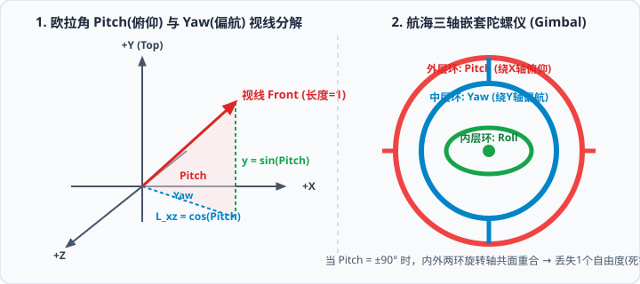

# 自由相机系统：欧拉角与视线几何推导

在三维交互场景中，第一人称/自由视角相机（Free Look Camera）必须支持鼠标拖拽旋转视野，以及键盘 WASD 键平移巡游。本模块从数学角度推导球面坐标系、欧拉角（Pitch / Yaw）到三维视线向量的转换，并解析万向节锁死防御机制。

---

## 1. 欧拉角（Euler Angles）定义

通过三个相互垂直的旋转角来描述相机在三维空间中的姿态：
- **俯仰角（Pitch）**：绕相机横轴（X 轴）上下俯仰抬头/低头。
- **偏航角（Yaw）**：绕世界纵轴（Y 轴）左右水平旋转转头。
- **翻滚角（Roll）**：绕相机视线轴（Z 轴）倾斜倒向。通常在第一人称自由相机中保持 $\text{Roll} = 0$ ，防止地平线歪斜。



---

## 2. 欧拉角转三维前向向量（Front Vector）几何推导

相机的视线朝向可以抽象为单位球面上的一点。设相机朝向为单位向量 $\mathbf{f} = (f_x, f_y, f_z)$ ，模长 $|\mathbf{f}| = 1$ 。

### 2.1 俯仰角 Pitch 引起的高度投影
设水平面（XZ 平面）为参考面，视线与水平面的夹角为 $\text{Pitch}$ ：
- 沿纵向 Y 轴的高度投影直接为正弦值：

$$
f_y = \sin(\text{Pitch})
$$

- 视线在 XZ 水平面上的正交投影长度为余弦值：

$$
L_{xz} = \cos(\text{Pitch})
$$

### 2.2 偏航角 Yaw 在 XZ 平面上的分解
投影到 XZ 平面上的线段长为 $L_{xz}$ ，它与坐标轴的夹角由 $\text{Yaw}$ 决定：
- 沿 X 轴分量：

$$
f_x = L_{xz} \cdot \cos(\text{Yaw}) = \cos(\text{Pitch}) \cdot \cos(\text{Yaw})
$$

- 沿 Z 轴分量：

$$
f_z = L_{xz} \cdot \sin(\text{Yaw}) = \cos(\text{Pitch}) \cdot \sin(\text{Yaw})
$$

综合得到前向方向向量公式（代码 `Camera::pitch` / `Camera::yaw`）：

$$
\mathbf{f} = \begin{pmatrix}
\cos(\text{Pitch}) \cdot \cos(\text{Yaw}) \\
\sin(\text{Pitch}) \\
\cos(\text{Pitch}) \cdot \sin(\text{Yaw})
\end{pmatrix}
$$

最终对 $\mathbf{f}$ 调用 `math::normalize` 确保数值精度。

---

## 3. 初始视角与 Windows 鼠标坐标映射

### 3.1 为什么初始偏航角设置为 $\text{Yaw} = -90^\circ$ ？
OpenGL 与本项目采用**右手观察空间**，相机默认初始朝向为负 $Z$ 轴，即 $\mathbf{f}_{\text{init}} = (0, 0, -1)$ 。
若将 $\text{Pitch} = 0$ 代入公式：

$$
f_x = \cos(\text{Yaw}), \quad f_y = 0, \quad f_z = \sin(\text{Yaw})
$$

要使 $\mathbf{f} = (0, 0, -1)$ ，必须满足：

$$
\cos(\text{Yaw}) = 0 \quad \text{且} \quad \sin(\text{Yaw}) = -1 \implies \text{Yaw} = -90^\circ \quad (\text{或 } 270^\circ)
$$

因此，相机的默认偏航角初始化为 $-90^\circ$ 。

### 3.2 鼠标 Y 轴反转映射
在 Windows 窗口事件 `WM_MOUSEMOVE` 中，屏幕坐标系以**左上角为原点**，光标向下移动时 $y$ 坐标数值递增（即 `yOffset = currentY - lastY > 0`）。
但在视线控制中，鼠标向下拖拽应当代表“低头俯角”，即 $\text{Pitch}$ 应当减小。因此在消息转发时需对纵向偏移取反：
```cpp
void Camera::onMouseMove(int x, int y) {
    if (mMouseMoving) {
        int xOffset = x - mCurrentMouseX;
        int yOffset = y - mCurrentMouseY;
        
        mCurrentMouseX = x;
        mCurrentMouseY = y;

        pitch(-yOffset); // 鼠标向下拖动时，降低仰角
        yaw(xOffset);    // 鼠标向右拖动时，增加偏航角
    }
}
```

---

## 4. 万向节死锁（Gimbal Lock）的具象化物理模型与规避

### 4.1 欧拉角的物理源头：航海机械陀螺仪
欧拉角并非凭空产生的数学抽象，它源自人类航海与航空中用于定姿的**三轴机械陀螺仪（Gimbal）**。
该装置由三个同心嵌套的金属圆环组成，每个圆环各负责感知一个轴向的旋转自由度：
- **外层环（Pitch 俯仰）**：绕水平横轴旋转，感知船体在风浪中的前后上下颠簸（点头/抬头）；
- **中层环（Yaw 偏航）**：绕垂直竖轴旋转，感知轮船在海面上的左右转舵（摇头）；
- **内层环（Roll 横滚）**：绕纵向中心轴旋转，感知船体受侧浪冲击时的左右倾斜（翻滚）。

（参见第 1 节右侧矢量图：当外层俯仰环旋转至 $\pm 90^\circ$ 时，内层环与中层环的旋转轴共面重合，导致丢失一个旋转自由度）。

### 4.2 万向节死锁（Gimbal Lock）的成因与自由度丢失
在欧拉角的旋转矩阵层层嵌套相乘时，**外层环的旋转会带动内层环的轴向一同发生空间位移**：
1. 当中层环（Yaw）或俯仰角（Pitch）旋转至特定角度（如 Pitch 向上仰起刚好达到 $\pm 90^\circ$ ）时；
2. 原本与外层环正交的内层环，**其旋转轴被强制拉入到了与外层环完全相同的旋转平面内，两轴共面重合**！
3. 此时，无论是旋转外层环还是旋转内层环，物体在三维空间中呈现出的都只是同一种轴向的旋转——**系统在瞬间永久丧失了一个维度的旋转自由度**，这就是著名的**万向节死锁（Gimbal Lock）**。

### 4.3 软光栅相机中的奇异点隐患
在第一人称（FPS）摄像机中，由于通常不使用四元数（Quaternion），死锁表现为直接的数学除零崩溃：
- 当相机完全垂直向上仰视（ $\text{Pitch} = +90^\circ$ ）或完全向下俯视（ $\text{Pitch} = -90^\circ$ ）时：
  $\mathbf{f} = (0, 1, 0)$ ，此时视线向量与世界参考上向量 $\mathbf{t} = (0, 1, 0)$ **共线平行**！
- 在计算右向量时： $\mathbf{r} = \mathbf{f} \times \mathbf{t} = (0, 0, 0)$ ，两平行向量叉乘结果为零向量！
- 零向量无法归一化，导致后续计算出的视图矩阵出现 `NaN` 崩溃，并且视角会发生剧烈的 $180^\circ$ 倒转（视觉翻滚）。

### 4.4 保护机制
在代码中对 `mPitch` 施加严格的边界截断限制：
```cpp
mPitch = std::clamp(mPitch, -89.0f, 89.0f);
```
将仰角限制在 $[-89^\circ, 89^\circ]$ 区间内，使得视线永远不会与竖直轴严格重合，从根本上杜绝了除零与奇异点翻转问题。

---

## 5. 多键并发位移合成（Bitmask 状态机）

键盘平移控制必须保证流畅、独立，支持对角线平移且互不干扰。`Camera` 采用位掩码（Bitmask）维护状态：
```cpp
#define NO_MOVE    0
#define MOVE_LEFT  0x001
#define MOVE_RIGHT 0x002
#define MOVE_FRONT 0x004
#define MOVE_BACK  0x008
```
- 按下按键：`mMoveState |= MOVE_FRONT;`
- 松开按键：`mMoveState &= ~MOVE_FRONT;`
- 在每帧 `Camera::update()` 中合成位移：

```cpp
  math::vec3f moveDirection = { 0.0f, 0.0f, 0.0f };
  math::vec3f front = mFront;
  math::vec3f right = math::normalize(cross(mFront, mTop));

  if (mMoveState & MOVE_FRONT) moveDirection += front;
  if (mMoveState & MOVE_BACK)  moveDirection -= front;
  if (mMoveState & MOVE_LEFT)  moveDirection -= right;
  if (mMoveState & MOVE_RIGHT) moveDirection += right;

  // 关键：对角线移动时必须重新归一化，防止斜向移动速度变为 √2 倍！
  if (math::lengthSquared(moveDirection) != 0) {
      moveDirection = math::normalize(moveDirection);
      mPosition += mSpeed * moveDirection;
  }
```
  最后将更新后的 `mPosition` 与 `mFront` 传入 `math::lookAt` 构建每一帧的视图矩阵。
