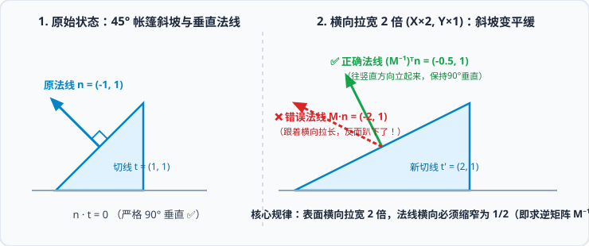

# 法线变换与模型矩阵逆转置数学推导

在顶点着色器（Vertex Shader）中，把模型的顶点放到世界空间只需直接乘以模型矩阵： $\mathbf{p}' = M \mathbf{p}$ 。
但是，顶点的**法线向量（Normal Vector）**却**绝对不能**直接乘以模型矩阵 $M$ ，而是必须乘以一个听起来很绕嘴的矩阵——**模型矩阵的“逆矩阵的转置”** $(M^{-1})^T$ 。

为什么一根好端端垂直于表面的法线箭头，跟着物体一起变换后就不垂直了？请先看下面这个 30 秒生活直觉。

---

## 0. 30 秒核心直觉：拉宽帐篷与斜坡上的旗杆

想象草地上搭着一个等腰直角三角形的**帐篷**，它的斜坡是 $45^\circ$ 。你在斜坡上**垂直插了一根旗杆（法线 $\mathbf{n}$ ）**，旗杆也是斜向上 $45^\circ$ 。

现在，我们把这个帐篷**在水平方向（X 轴）拉宽 2 倍，高度（Y 轴）不变**：



1. **看帐篷斜坡（表面切线 $\mathbf{t}$ ）**：帐篷被横向拉宽后，**斜坡变得更平缓、更接近水平地面了**。
2. **想一想旗杆（法线 $\mathbf{n}$ ）该怎么动才能继续垂直于斜坡？**
   - 既然斜坡变得更平（更接近水平）了，垂直于斜坡的旗杆应该**往竖直方向立起来（水平分量必须变小）**！
3. **如果错误地让旗杆也直接乘以模型矩阵 $M$ （横向拉宽 2 倍）会发生什么？**
   - 旗杆的水平分量也被拉长了 2 倍，导致**旗杆不但没立起来，反而往水平方向趴下了**！此时的旗杆和斜坡夹角再也不是 $90^\circ$ ，算出来的光照完全是错的！

**⚡ 一句话顿悟“为什么要算逆矩阵”**：
> **表面在某个方向被拉宽 $2$ 倍（ $\times 2$ ），法线在该方向反而必须缩窄为 $\frac{1}{2}$ （ $\times \frac{1}{2}$ ）才能继续保持垂直！“跟原来的缩放反着来”，在数学上就是求逆矩阵 $M^{-1}$ ！**

---

## 1. 用具体数字验证：直接乘 $M$ 到底错在哪？

把上面的帐篷变成简单的二维坐标算一下，一目了然：
- **变换前**：
  - 斜坡切线向量： $\mathbf{t} = (1, 1)$
  - 垂直于斜坡的法向量： $\mathbf{n} = (-1, 1)$
  - 验证垂直（点积为 0）： $\mathbf{n} \cdot \mathbf{t} = (-1)\times 1 + 1\times 1 = \mathbf{0}$ （严格垂直 ✅）

- **施加非均匀缩放（X 轴拉宽 2 倍，Y 轴不变）**：

$$
M = \begin{bmatrix}
2 & 0 \\
0 & 1
\end{bmatrix}
$$

  - 新的斜坡切线： $\mathbf{t}' = M \mathbf{t} = (2, 1)$
  - **错误做法**（法线直接乘 $M$ ）： $\mathbf{n}_{\text{wrong}} = M \mathbf{n} = (-2, 1)$
    - 检查是否还垂直： $(-2)\times 2 + 1\times 1 = \mathbf{-3 \neq 0}$ （**彻底不垂直了 ❌**）
  - **正确做法**（法线乘逆转置矩阵 $(M^{-1})^T$ ，即 X 轴缩放变为倒数 $1/2$ ）： $\mathbf{n}_{\text{correct}} = (-0.5, 1)$
    - 检查是否还垂直： $(-0.5)\times 2 + 1\times 1 = -1 + 1 = \mathbf{0}$ （**完美保持垂直 ✅**）

---

## 2. 只有 5 行的极简数学推导：为什么是 $(A^{-1})^T$ ？

为什么除了“求逆 $A^{-1}$ ”之外，外面还要套一个“转置 $T$ ”？因为在线性代数中，两个列向量做点积 $\mathbf{n} \cdot \mathbf{t}$ ，写成矩阵乘法需要把左边的向量横过来（转置）： $\mathbf{n}^T \mathbf{t} = 0$ 。

设顶点和切线乘的是线性矩阵 $A$ （即 $\mathbf{t}' = A \mathbf{t}$ ），我们想找一个法线专用矩阵 $G$ （即 $\mathbf{n}' = G \mathbf{n}$ ），使得**变换后它们依然垂直（点积依然为 0）**：

$$
\begin{aligned}
(\mathbf{n}')^T \mathbf{t}' &= 0 \\
(G \mathbf{n})^T (A \mathbf{t}) &= 0 \quad &\text{（第1步：代入 }\mathbf{n}'\text{ 和 }\mathbf{t}'\text{）} \\
\mathbf{n}^T (G^T A) \mathbf{t} &= 0 \quad &\text{（第2步：拆括号转置 }(G\mathbf{n})^T = \mathbf{n}^T G^T\text{）}
\end{aligned}
$$

因为原本就有 $\mathbf{n}^T \mathbf{t} = 0$ ，只要让中间括号里的 $G^T A$ **等于单位矩阵 $I$ （相当于完全抵消）**，等式就永远成立：

$$
G^T A = I \implies G^T = A^{-1} \implies \mathbf{G = (A^{-1})^T}
$$

**推导完毕！** 那个转置符号 $T$ ，纯粹是因为点积时把 $\mathbf{n}$ 横过来放左边带来的副产物。

---

## 3. 工程实战中的三种情况：什么时候可以偷懒不算逆转置？

求 $4\times 4$ 矩阵的逆矩阵比较费 CPU，实战中可以根据模型干了什么变换来决定是否简化：

| 模型做了什么变换？ | 法线会不会歪？ | 法线该乘什么矩阵？ | 原因大白话 |
| :--- | :---: | :--- | :--- |
| **1. 只做了平移 + 旋转**<br>（最常见的刚体运动） | **不会歪** | **直接乘原矩阵 $M$ 即可！** | 物体没变形，旋转矩阵是正交矩阵，它的逆矩阵本来就等于它的转置（ $R^{-1}=R^T$ ），再转置一次又变回 $R$ 自己了！ |
| **2. 等比例均匀缩放**<br>（X/Y/Z 全放大 2 倍） | **方向不歪**<br>（只是长度变了） | **直接乘原矩阵 $M$ + 归一化** | 帐篷整体放大 2 倍，坡度根本没变，最后调一次 `normalize()` 把法线长度缩回 1 就行。 |
| **3. 非均匀缩放 / 拉伸变形**<br>（比如 X 拉宽 2 倍，Y 不变） | **严重变歪！** | **必须老老实实算逆转置** $(M^{-1})^T$ | 坡度变了，不乘逆转置光照就会彻底错乱。 |

---

## 4. 为什么代码里法线的第 4 维 $w$ 必须填 `0.0f`？

在 `LightShader::vertexShader` 代码中，你会看到这一行：
```cpp
output.mNormal = math::transpose(math::inverse(mModelMatrix)) * math::vec4f(normal, 0.0f);
```
**为什么最后一位填 `0.0f` 而不是 `1.0f`？**
- 回想 [00_仿射变换起源与二维齐次坐标推导.md](file:///d:/Graphic/Graphic/docs/数学/00_仿射变换起源与二维齐次坐标推导.md)：
  - $w = 1$ 代表**有位置的点**（矩阵第 4 列的平移量会加到坐标上）；
  - $w = 0$ 代表**纯方向向量**（把矩阵第 4 列的平移量乘以 0 彻底屏蔽掉）。
- 法线只代表“表面朝哪边倾斜”。你把一张桌子从客厅平移到卧室，桌面依然朝上，法线方向丝毫不会因为平移而改变！填 `0.0f` 就是为了防止平移数据污染法线方向。
