# 现代软光栅渲染管线架构总览

本项目实现了一套严格遵循现代 OpenGL（Core Profile）架构的可编程 CPU 软光栅渲染器。管线屏蔽了底层平台的固定流水线，完整模拟了 GPU 顶点拉取、着色器执行、视锥体裁剪、光栅化、插值恢复直至逐片元测试的十大核心阶段。

---

## 0. 渲染技术宏观认知与场景三要素

在深入具体的代码与管线流转之前，我们需要从宏观上理解计算机图形学“渲染”的本质：**将存储在计算机内存中的离散三维几何与材质数据，通过图形算法流水线加工，最终映射为屏幕发光像素阵列的过程。**

### 0.1 实时渲染 vs 离线渲染

| 分类维度 | 实时渲染（Real-Time Rendering） | 离线渲染（Offline Rendering） |
| :--- | :--- | :--- |
| **首要目标** | **高帧率与即时交互性**（30 ~ 60+ FPS） | **极致物理画质与光影真实度** |
| **典型应用** | 电子竞技游戏（如 CS:GO）、VR/AR、CAD 交互建模 | 影视动画特效（如迪士尼/皮克斯电影）、建筑效果图 |
| **核心算法** | **多边形光栅化（Rasterization）**、近似经验光照模型 | **路径追踪 / 光线追踪（Path / Ray Tracing）**、蒙特卡洛积分 |
| **单帧开销** | 必须在 16ms ~ 33ms 内全部计算完成 | 单帧耗时数小时至数天不等 |
| **本工程定位** | **纯 CPU 模拟 GPU 硬件光栅化管线**，深入理解现代实时渲染底层基石 | - |

### 0.2 构成三维场景的核心三要素
无论是简单的软光栅还是商业游戏引擎，任何虚拟场景均由以下三大要素统合而成：
1. **统一的世界参考坐标系（World Space）**：三维空间中固定不动的全局物理原点 $(0, 0, 0)$ ，所有模型、灯光与摄像机的位置均以此为绝对参照；
2. **物体网格模型（Mesh & Triangle）**：在图形学中，一切复杂的曲面实体（角色、载具、房屋）均在离散化后**以三角形面片（Triangle Primitive）为最小拓扑单元**构成，辅以顶点属性（坐标、颜色、法线、UV）与索引阵列；
3. **虚拟摄像机（Camera）**：场景的“眼睛”，拥有空间位置、凝视方向以及关键光学参数（**焦距与视张角 FOV**，决定人眼所能感知的空间开合范围）。

---

## 1. 完整渲染管线数据流拓扑图

```mermaid
flowchart TD
    S1["1. 顶点着色器 (Vertex Shader) 【可编程阶段】<br/>MVP 空间变换 / 法线逆转置变换 / 输出 4D 齐次裁剪坐标"]
    S2["2. 图元装配 (Primitive Assembly) 【固定功能】<br/>按索引组装 DRAW_TRIANGLES / DRAW_LINES"]
    S3["3. 背面剔除 (Back-Face Culling) 【固定配置】<br/>顺/逆时针 (CW/CCW) 法向量 Z 轴符号检测"]
    S4["4. 视锥体裁剪 (Clipping) 【固定功能】<br/>Sutherland-Hodgman 7 平面裁剪 + 扇形三角剖分缝补"]
    S5["5. 透视除法 (Perspective Division) 【固定功能】<br/>齐次坐标除以 w 进入 NDC [-1, 1]³ / 记录 1/w 并预除顶点属性"]
    S6["6. 视口屏幕变换 (Screen Mapping) 【固定配置】<br/>NDC 映射至屏幕物理像素坐标 [0, W] × [0, H]"]
    S7["7. 光栅化 (Rasterization) 【固定功能】<br/>AABB 包围盒扫描 + 单次叉积复用内外判定与重心插值"]
    S8["8. 透视恢复 (Perspective Recover) 【固定功能】<br/>(Attr / w) / (1 / w) 还原真实 3D 属性，消除透视畸变"]
    S9["9. 片元着色器 (Fragment Shader) 【可编程阶段】<br/>纹理采样 (Nearest / Bilinear) + Lambert 漫反射与环境光照"]
    S10["10. 逐片元操作 (Per-Fragment Operations) 【固定配置】<br/>Z-Buffer 深度测试 (Depth Test) + Alpha 透明度混合 (Blending)"]
    FB[("FrameBuffer 帧缓冲区<br/>(ColorBuffer 颜色缓冲 + DepthBuffer 深度缓冲)")]

    S1 -->|"std::vector&lt;VsOutput&gt;"| S2 --> S3 --> S4 --> S5 --> S6 --> S7 --> S8 --> S9 -->|"std::vector&lt;FsOutput&gt;"| S10 --> FB

    style S1 fill:#dbeafe,stroke:#0284c7,stroke-width:2px,color:#0f172a
    style S9 fill:#dbeafe,stroke:#0284c7,stroke-width:2px,color:#0f172a
    style FB fill:#dcfce7,stroke:#16a34a,stroke-width:2px,color:#0f172a
```



---

## 2. 核心状态机与管线驱动（`GPU::drawElement`）

管线的主驱动函数为 `GPU::drawElement`，它接收绘制模式、起始偏移与图元索引数量：
```cpp
void GPU::drawElement(const uint32_t& drawMode, const uint32_t& first, const uint32_t& count);
```

### 2.1 阶段一：顶点着色器执行（`vertexShaderStage`）
- 从当前绑定的 `mCurrentEBO` 索引缓冲中，按 `uint32_t` 顺序逐个读出顶点索引。
- 依据当前 `mCurrentVAO` 的属性绑定字典，在 `mBufferMap` 中寻址各属性所在的 VBO 内存。
- 调用活动着色器 `mShader->vertexShader(bindingMap, mBufferMap, index)`，返回裁剪空间顶点对象 `VsOutput`。

### 2.2 阶段二：图元装配与背面剔除
- 若为三角形绘制（`DRAW_TRIANGLES`），每三个连续顶点装配为一个三角形。
- 开启剔除后，调用 `Clipper::cullFace`，基于投影后左手系下法向量的 $z$ 符号提前过滤背向相机表面。

### 2.3 阶段三：齐次裁剪与多边形缝补
- 对幸存图元调用 `Clipper::doClipSpace`，在 4D 齐次空间通过 Sutherland-Hodgman 算法过滤 7 个超平面，对穿插多边形生成交点并扇形三角剖分。

### 2.4 阶段四：透视除法与预除 $w$
- 计算 `1.0f / vsOutput.mPosition.w`，归一化坐标进入 NDC $[-1, 1]^3$ 。
- 对颜色、法线、UV 等全部顶点属性**预先乘以** $1/w$ ，为后续正确的透视插值做准备。

### 2.5 阶段五：视口变换（Screen Mapping）
- 乘以预计算的屏幕映射矩阵 `mScreenMatrix`，将归一化坐标转换到屏幕像素空间： $(x, y) \in [0, W] \times [0, H]$ ，深度 $z \in [0, 1]$ 。

### 2.6 阶段六：光栅化与插值
- 调用 `Raster::rasterize`，采用优化的 AABB 包围盒扫描算法，单次叉积同时判定像素内外并求解屏幕二维重心坐标，对所有预除属性完成屏幕空间线性插值。

> #### 核心辨析：片元（Fragment）与像素（Pixel）的本质区别
> 初学图形学常将“片元”与“像素”混为一谈。严格来说：
> - **物理像素（Pixel）**：屏幕硬件上的物理发光单元（由红、绿、蓝三色子发光体组成），具有固定的整数屏幕坐标 $(x, y)$ ，其最终颜色存储在全局帧缓冲区（FrameBuffer）中。
> - **图元片元（Fragment）**：光栅化阶段对每个图元面片进行几何离散化后生成的**候选计算单位**。片元携带着该位置插值出的空间深度、颜色、法线与纹理坐标。
> - **两者的映射关系**：
>   - 当屏幕上只有一个完全不透明的简单多边形时，每个片元一一对应一个物理像素；
>   - 当场景存在**多层重叠几何体**（如前景人物遮挡背景山峦、半透明玻璃与墙壁重叠）时，**同一个屏幕像素位置会同时生成多个分属不同三角形的候选片元**！
>   - 这些重叠片元各自独立进入片元着色器计算颜色，最终必须通过阶段九的**深度测试（遮挡剔除）**与**Alpha 混合（透明融合）**进行残酷决选，胜出或混合后的最终结果才会被写上屏幕成为“像素”。

### 2.7 阶段七：透视恢复（Perspective Recover）
- 离散出的每个候选片元，其属性除以插值后的 $\dfrac{1}{w}$ ，还原为真实空间属性。

### 2.8 阶段八：片元着色器执行（`fragmentShaderStage`）
- 调用用户自定义的 `mShader->fragmentShader`，执行材质漫反射纹理采样、光照模型计算，输出量化到 $[0, 255]$ 的目标颜色与屏幕深度。

### 2.9 阶段九：逐片元测试与帧缓冲写入
- **深度测试**：比较片元深度与 `mDepthBuffer` 记录值，不通过则丢弃。
- **Alpha 混合**：根据片元透明度与帧缓冲当前色执行线性插值。
- **写入上屏**：更新像素对应的 `mColorBuffer` 与 `mDepthBuffer`。

---

## 3. 核心设计抉择：除以 $w$ 与除以 $z$ 的本质解耦

在图形流水线设计中，为什么必须使用 4D 齐次坐标并执行“除以 $w$ ”，而不能直接在 3D 空间中“除以 $z$ ”？

### 3.1 方案对比

| 特性维度 | 除以 $w$ （现代管线标准方案） | 除以 $z$ （朴素简化方案） |
| :--- | :--- | :--- |
| **坐标系统** | 4D 齐次坐标系 $(x, y, z, w)$ | 3D 欧几里得坐标 $(x, y, z)$ |
| **变换统一性** | 平移、旋转、缩放、正交、透视全部统一为 $4 \times 4$ 矩阵乘法 | 投影无法使用矩阵统一表达，需特判分支 |
| **深度信息保存** | **解耦**： $w$ 承载透视缩放因子，原 $z$ 变换后保留在 $z_{\text{clip}}$ 中供深度缓冲使用 | **冲突**： $z$ 既作除数缩放又作深度值，除法后原始 $z$ 丢失 |
| **正交投影兼容** | 统一处理：正交投影矩阵输出 $w=1$ ，除以 $w$ 保持平行投影不变形 | 无法统一，需要对正交/透视走两套不同的代码管线 |
| **裁剪效率** | 在齐次空间直接使用不等式 $-w \le x, y, z \le w$ 进行多边形快速切分 | 必须在除法后裁剪，容易遇到 $z \to 0$ 附近的除零奇异点 |

### 3.2 深度与透视的解耦原理
若采用除以 $z$ 方案：

$$
x_{\text{ndc}} = \frac{x}{z}, \quad y_{\text{ndc}} = \frac{y}{z}
$$

此时第三维的深度值将无法定义。若设 $z_{\text{ndc}} = 1$ ，则丢失了所有物体的纵深关系，深度测试彻底失效；若设 $z_{\text{ndc}} = f(z)$ ，则需要额外维护非线性映射逻辑并破坏了矩阵管线的整洁性。

在除以 $w$ 方案中：
- 投影矩阵将观察空间的深度信息 $-z_{\text{view}}$ 存入输出的 $w_{\text{clip}}$ 分量；
- 同时利用投影矩阵第 3 行将 $z_{\text{view}}$ 映射为满足深度测试需求的 $z_{\text{clip}}$ ；
- 执行透视除法时，各分量同时除以 $w_{\text{clip}}$ ，即完成了透视缩放（近大远小），又得到了规范化的 $z_{\text{ndc}} \in [-1, 1]$ 。

---

## 4. 坐标变换端到端数值推导演练

为直观展示顶点在整条渲染管线中的数值流变，以下选取一个具体的空间顶点进行手工推导演算：

### 4.1 场景参数设定
- **窗口大小**： $W = 800, H = 600$
- **视锥体参数**： $\text{FOV} = 60^\circ$ （半角 $\theta = 30^\circ$ ），宽高比 $\text{aspect} = \frac{800}{600} = 1.3333$
- **近/远平面**： $n = 0.1, f = 100.0$
- **投影矩阵常量**：

$$
f_{\text{cot}} = \cot(30^\circ) = \sqrt{3} \approx 1.732
$$

$$
P_{0,0} = \frac{f_{\text{cot}}}{\text{aspect}} = \frac{1.732}{1.3333} \approx 1.299, \quad P_{1,1} = f_{\text{cot}} \approx 1.732
$$

$$
P_{2,2} = \frac{-(100 + 0.1)}{100 - 0.1} \approx -1.002, \quad P_{2,3} = \frac{-2 \times 100 \times 0.1}{100 - 0.1} \approx -0.2002
$$

### 4.2 空间变换链数值推导
假设待绘制的顶点经过模型变换与视图变换后，在**观察空间（View Space）**中的坐标为：

$$
\mathbf{P}_{\text{view}} = (2.0, 1.0, -4.0, 1.0)^T
$$

（该点位于相机右侧 2 单位、上方 1 单位、相机前方 4 单位处）

#### 步骤 1：透视投影矩阵变换 $\to$ 齐次裁剪空间（Clip Space）

$$
\mathbf{P}_{\text{clip}} = P_{\text{proj}} \cdot \mathbf{P}_{\text{view}} = \begin{bmatrix}
1.299 \times 2.0 \\
1.732 \times 1.0 \\
-1.002 \times (-4.0) + (-0.2002) \times 1.0 \\
-1.0 \times (-4.0)
\end{bmatrix} \approx \begin{bmatrix}
2.598 \\
1.732 \\
3.8078 \\
4.000
\end{bmatrix}
$$

- 此时 $w_{\text{clip}} = 4.0 = -z_{\text{view}}$ 。

#### 步骤 2：齐次空间视锥体裁剪判断（Clipping）
检验不等式 $-w \le x, y, z \le w$ ：

$$
-4.0 \le 2.598 \le 4.0 \quad (\text{通过})
$$

$$
-4.0 \le 1.732 \le 4.0 \quad (\text{通过})
$$

$$
-4.0 \le 3.808 \le 4.0 \quad (\text{通过})
$$

点完全位于视锥体内，无需剔除或分割。

#### 步骤 3：透视除法 $\to$ 归一化设备坐标（NDC）
所有分量除以 $w_{\text{clip}} = 4.0$ ：

$$
x_{\text{ndc}} = \frac{2.598}{4.0} \approx 0.6495
$$

$$
y_{\text{ndc}} = \frac{1.732}{4.0} \approx 0.4330
$$

$$
z_{\text{ndc}} = \frac{3.8078}{4.0} \approx 0.9520
$$

得到的 NDC 坐标落在 $[-1, 1]^3$ 规范化立方体内。

#### 步骤 4：视口变换（Screen Mapping） $\to$ 屏幕物理像素与深度

$$
x_{\text{screen}} = \frac{x_{\text{ndc}} + 1.0}{2.0} \times W = \frac{0.6495 + 1.0}{2.0} \times 800 \approx 659.8 \approx 660 \text{ 像素}
$$

$$
y_{\text{screen}} = \frac{y_{\text{ndc}} + 1.0}{2.0} \times H = \frac{0.4330 + 1.0}{2.0} \times 600 \approx 429.9 \approx 430 \text{ 像素}
$$

$$
z_{\text{depth}} = \frac{z_{\text{ndc}} + 1.0}{2.0} = \frac{0.9520 + 1.0}{2.0} \approx 0.976
$$

该观察空间中的顶点最终精准映射到屏幕物理坐标 $(660, 430)$ ，对应片元深度为 $0.976$ ，送入深度缓冲区参与遮挡比对。
