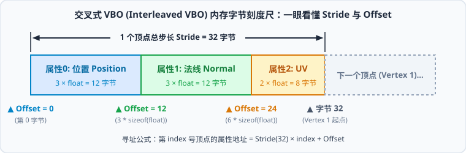

# 显存抽象与顶点数组状态机（VAO / VBO / EBO）

初学现代 OpenGL 或软光栅时，一上来就要写一堆 `genBuffers`、`bindBuffer`、`genVertexArrays`、`vertexAttributePointer`，还要算什么 `Stride`（步长）和 `Offset`（偏移）。很多人写了半天三角形画出来了，但脑子里依然一头雾水：**VBO、EBO、VAO 这三个东西到底谁存数据？谁管谁？**

用下面这个**“纯数字磁带 + 格式说明书 + 连线号码牌”**的直觉比喻，30 秒就能把它们的关系理得清清楚楚。

---

## 0. 30 秒核心直觉：磁带、说明书与号码牌

当你想让显卡（或软光栅 `GPU`）画一个 3D 模型时，需要配合使用这三样东西：

### 1. VBO（Vertex Buffer Object，顶点缓冲）= “一盘没写表头的纯数字磁带”
- 你在内存里开辟了一大块连续字节（`byte* mBuffer`），把所有顶点的坐标、颜色、法线、UV 统统塞了进去：
  `[0.5, 0.0, 0.0,  1.0, 0.0, 0.0,  0.0, 1.0,  -0.5, 0.0, ...]`
- **注意**：VBO **非常傻**！它只是一块用来装二进制数据的仓库（仓库编了号叫 `vboId = 1`）。它自己**根本不知道**里面存的是 `float` 还是 `int`，也不知道前 3 个数是坐标还是颜色！

### 2. VAO（Vertex Array Object，顶点数组对象）= “贴在磁带盒上的《格式说明书》”
- 既然 VBO 只是一串没表头的数字，着色器怎么读它？这就需要 **VAO**！
- **⚡ 核心铁律：VAO 自己不存半个顶点的数据！它只是一本薄薄的《格式说明书（字典）》**。
- 它在笔记本上记着：
  - **0 号属性（位置）**：请去 **1 号 VBO** 里拿，每隔 **32 字节（`Stride`）**是一个新顶点，从每个顶点的第 **0 字节（`Offset`）**开始读 **3 个 float**。
  - **1 号属性（法线）**：请去 **1 号 VBO** 里拿，每隔 **32 字节（`Stride`）**是一个新顶点，跳过前面的坐标，从第 **12 字节（`Offset`）**开始读 **3 个 float**。
- **为什么要有 VAO？** 因为场景里有几百个模型，每个模型配好一本 VAO 说明书后，渲染时只需喊一声 `bindVertexArray(vaoId)`（换一本说明书），所有顶点属性的读取规则瞬间切换完毕！

### 3. EBO（Element Buffer Object，索引缓冲）= “连线拼图号码牌”
- 想象你要画一个长方形（由 2 个三角形拼成）。长方形明明只有 **4 个角（4 个顶点）**，但如果不用索引，你得往 VBO 里塞 $3 + 3 = \mathbf{6}$ 个顶点（对角线上的两个顶点被重复抄了两遍，浪费显存！）。
- 有了 **EBO**，你只需要在 VBO 里存 **4 个不重复的顶点（编号 0, 1, 2, 3）**，然后在 EBO 里写一串号码牌：**`[0, 1, 2,   0, 2, 3]`**，告诉 GPU：“先拿 0-1-2 连成第一个三角形，再拿 0-2-3 连成第二个三角形！”

---

## 1. 一眼看懂 `Stride`（步长）与 `Offset`（偏移）

在配置 VAO 说明书时，调用的函数是：
```cpp
sgl->vertexAttributePointer(属性编号, 读几个float, 步长Stride, 起始偏移Offset);
```
很多人在填最后两个参数 `Stride` 和 `Offset` 时容易算错。其实只要画一把**“内存字节刻度尺”**（记住 **1 个 `float` = 4 字节**），连心算都不用：

### 实战最推荐：交叉式布局（Interleaved VBO，所有属性打包在一个结构体里）

就像排队体检一样，每个人的“位置(3个float) + 法线(3个float) + UV(2个float)”紧挨着放在一起：



对着上面这把尺子，写代码配置 VAO 就像填空一样简单：

```cpp
struct Vertex {
    math::vec3f position;  // 占 12 字节 (0 ~ 11)
    math::vec3f normal;    // 占 12 字节 (12 ~ 23)
    math::vec2f texCoords; // 占 8  字节 (24 ~ 31)
};                         // 单个顶点总长 sizeof(Vertex) = 32 字节

// 绑定磁带 (VBO)
sgl->bindBuffer(ARRAY_BUFFER, vboId);

// 往说明书 (VAO) 上写三条读取规则：
// 规则0 (位置): 读 3 个 float, 总步长 32 字节, 从第 0 字节开始
sgl->vertexAttributePointer(0, 3, sizeof(Vertex), 0);

// 规则1 (法线): 读 3 个 float, 总步长 32 字节, 跳过前面 3 个 float (第 12 字节) 开始
sgl->vertexAttributePointer(1, 3, sizeof(Vertex), sizeof(float) * 3);

// 规则2 (UV)  : 读 2 个 float, 总步长 32 字节, 跳过前面 6 个 float (第 24 字节) 开始
sgl->vertexAttributePointer(2, 2, sizeof(Vertex), sizeof(float) * 6);
```

---

## 2. 对比：分离式布局 vs 交叉式布局（为什么工程强烈推荐交叉式？）

除了上面把一个顶点的属性打包放一起的**交叉式（Interleaved）**，还有一种在早期教程（如 `10_vao.cpp`）里常见的**分离式（Separate VBOs）**：
- **分离式**：搞 3 盘不同的磁带——1 号 VBO 只存所有人的位置，2 号 VBO 只存所有人的颜色，3 号 VBO 只存所有人的 UV。
- **为什么现代游戏引擎 99% 都用交叉式（打包在一起）？**
  - **因为 CPU/GPU 的缓存命中率（Cache Locality）！**
  - 顶点着色器在加工第 `i` 号顶点时，需要**同时**用到它的位置、法线和 UV。
  - 如果用**交叉式**，这三个属性在内存里紧挨着（总共才 32 字节），CPU 只需从内存抓一次（一条缓存行 Cache Line 是 64 字节），就把整个顶点的所有属性全装进高速缓存了！
  - 如果用**分离式**，CPU 得在三个相隔十万八千里的内存地址之间来回跳着读，频繁引发缓存未命中（Cache Miss），性能大打折扣。

---

## 3. 软光栅底层是怎么靠 VAO 说明书掏出数据的？（源码揭秘）

看懂了上面的尺子，再看软光栅底层 `Shader::getVector` 的源码（`gpu/shader.cpp`），你会发现它甚至简单得让人发笑——就是一个乘法加一个加法：

1. **查说明书**：VAO 里存了一个字典 `std::map<uint32_t, BindingDescription> mBindingMap`，每个条目记着：

```cpp
   struct BindingDescription {
       uint32_t mVboId;    // 去几号 VBO 磁带拿？
       size_t   mItemSize; // 读几个 float？
       size_t   mStride;   // 每个顶点跨度多少字节？
       size_t   mOffset;   // 属性在顶点内部偏移多少字节？
   };
```
2. **算字节地址**：当顶点着色器正在处理第 `index` 号顶点，想要读取它的某项属性时，直接用小学算术算出内存起始字节位置：

$$
\text{字节地址} = \underbrace{\text{Stride} \times \text{index}}_{\text{先跳过前 index 个完整顶点}} + \underbrace{\text{Offset}}_{\text{再跳到顶点内部的具体属性}}
$$

3. **拷贝数据**：直接调用 `memcpy` 从 VBO 内存的该字节地址处，拷出 `mItemSize * sizeof(float)` 个字节塞进 `vec4f`，就完成了顶点属性的自动拉取！
