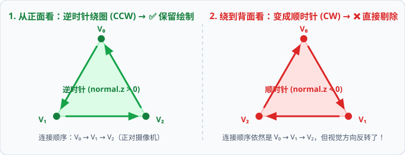
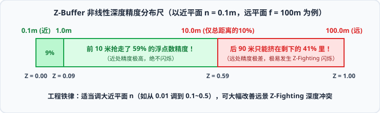

# 背面剔除与深度测试（Z-Buffer）

在 3D 世界里，一个闭合的立方体或恐龙模型，总有一半的面是背对着摄像机的；而且场景里近处的物体会挡住远处的物体。
如果一股脑儿把所有三角形全画到屏幕上，不仅浪费一半算力，还会出现“后画的远处背景把先画的近处主角盖住”的穿模灾难。

解决这两个可见性问题的两大看家法宝，就是**背面剔除（Back-Face Culling）**与**深度测试（Z-Buffer）**。

---

## 0. 30 秒核心直觉：玻璃门贴纸与擂台挑战赛

### 直觉一：背面剔除 = “看透明玻璃门上的时钟贴纸”
显卡怎么知道一个三角形是**正对着你**，还是**背对着你**？
- 想象你在透明玻璃门上贴了一张时钟贴纸，在表盘边缘标了三个点 $V_0 \to V_1 \to V_2$ ，规定**从正面看过去，这三个点是按【逆时针】排列的**。
- 现在，你绕到玻璃门的**背面**，透过玻璃再看这三个点 $V_0 \to V_1 \to V_2$ —— **神奇的事情发生了：从背面看过去，它们的排列方向自动变成了【顺时针】！**
- **结论**：只要规定建模时所有正面的顶点都按**逆时针（CCW）**顺序连线，那么投影到 2D 屏幕上之后：
  - 凡是在屏幕上依然呈**逆时针**绕圈的三角形 $\rightarrow$ **正面（留着画）**！
  - 凡是在屏幕上变成**顺时针**绕圈的三角形 $\rightarrow$ **转到背面去了（直接扔掉不画，白省 50% 算力）**！



---

### 直觉二：深度测试（Z-Buffer）= “每个像素格子的擂台挑战赛”
背面剔除只能扔掉单个物体自己的后背，那“近处的苹果挡住远处的杯子”怎么解决？
- 早期人们用**画家算法**：先在 CPU 里把所有三角形按远近排个序，先画最远的背景，最后画最近的前景。但如果两个三角形**互相交叉穿插（你挡我左半边，我挡你右半边）**，根本没法排序！
- **Z-Buffer（深度缓冲）的天才想法**：别按整个三角形排序了，**干脆让屏幕上的每一个像素点各自摆一个“比武擂台”！**
  1. 屏幕有 $800 \times 600$ 个像素，我们就配套建一张 $800 \times 600$ 的**距离记录表（`float mDepthBuffer[]`）**，记录当前占领该像素的擂主离镜头有多远（ $0.0$ 代表贴着镜头最近， $1.0$ 代表最远极限）。
  2. **每一帧开局前**：把所有格子的记录统统清空填成 **`1.0`（最远空气）**。
  3. **攻擂比武**：每当光栅化算出一个新片元想涂到 $(x, y)$ 像素上时，先拿它的距离 `newDepth` 和表里的擂主 `oldDepth` 比一下：
     - **`newDepth < oldDepth`（挑战者离镜头更近！）** $\rightarrow$ **攻擂成功！** 把自己的颜色涂上屏幕，并把擂台记录刷新为 `newDepth`！
     - **`newDepth >= oldDepth`（挑战者躲在擂主后面）** $\rightarrow$ **被挡住了！** 直接淘汰扔掉！
  4. **最大好处**：不管你先画近处还是先画远处，也不管两个物体怎么交叉穿插，每个像素独立打擂台，最后留在屏幕上的**永远是离镜头最近的那一层**！

---

## 1. 背面剔除的数学判据与代码实现（`Clipper::cullFace`）

在屏幕上，怎么用一行数学公式判断三个点 $V_0, V_1, V_2$ 是逆时针还是顺时针？
**答：算两条边向量的叉乘（ $\mathbf{n} = (V_1 - V_0) \times (V_2 - V_0)$ ），看结果的 $Z$ 分量正负号！**

$$
\mathbf{e}_1 = V_1 - V_0, \quad \mathbf{e}_2 = V_2 - V_0
$$

$$
n_z = e_{1x} e_{2y} - e_{1y} e_{2x}
$$

> [!IMPORTANT]
> **注意手性小细节**：在经过透视投影矩阵（含 $-1$ 项）变换进入 NDC 空间后，原本向外的右手系翻转成了 $Z$ **轴指向屏幕里面的左手坐标系**。
> 在该屏幕坐标系下：
> - 当顶点在屏幕上呈**逆时针（`FRONT_FACE_CCW`）**时，算出来的叉积 $n_z > 0$ ；
> - 当顶点在屏幕上呈**顺时针（`FRONT_FACE_CW`）**时，算出来的叉积 $n_z < 0$ 。

### 状态机判定速查表

| 剔除模式 (`cullFace`) | 正面规定 (`frontFace`) | 想要留下的面 | 保留条件（返回 `true` 不剔除） |
| :--- | :--- | :---: | :---: |
| **`BACK_FACE`（剔除背面，最常用）** | `FRONT_FACE_CCW`（逆时针为正） | 正面 | **`normal.z > 0`** |
| **`BACK_FACE`（剔除背面）** | `FRONT_FACE_CW`（顺时针为正） | 正面 | **`normal.z < 0`** |
| **`FRONT_FACE`（剔除正面，特殊特效）** | `FRONT_FACE_CCW`（逆时针为正） | 背面 | **`normal.z < 0`** |
| **`FRONT_FACE`（剔除正面）** | `FRONT_FACE_CW`（顺时针为正） | 背面 | **`normal.z > 0`** |

---

## 2. 深度测试（Z-Buffer）的代码落地

### 2.1 每帧开局：把擂台记录全重置为最远 `1.0f`
在每一帧渲染开头的 `GPU::clear()` 中：
```cpp
// 将 800x600 个像素的深度擂台记录全部初始化为最远端 1.0f
std::fill_n(mFrameBuffer->mDepthBuffer, pixelSize, 1.0f);
```

### 2.2 逐片元攻擂比武（`GPU::depthTest`）
当一个片元着色完成后，尝试写入帧缓冲前执行测试：
```cpp
bool GPU::depthTest(const FsOutput& output) {
    // 1. 算出当前像素在一维数组里的格子下标
    uint32_t pixelPos = output.mPixelPos.y * mFrameBuffer->mWidth + output.mPixelPos.x;
    float oldDepth = mFrameBuffer->mDepthBuffer[pixelPos];

    switch (mDepthFunc) {
    case DEPTH_LESS: // 默认规则：数值更小（离镜头更近）的挑战成功
        if (output.mDepth < oldDepth) {
            mFrameBuffer->mDepthBuffer[pixelPos] = output.mDepth; // 刷新擂台深度记录
            return true;                                          // 准许把颜色涂上屏幕
        }
        return false;                                             // 被挡住，直接丢弃！
    case DEPTH_GREATER:
        if (output.mDepth > oldDepth) {
            mFrameBuffer->mDepthBuffer[pixelPos] = output.mDepth;
            return true;
        }
        return false;
    default:
        return false;
    }
}
```

---

## 3. 进阶必知：为什么远处两个贴得很近的面会“疯狂闪烁”？（Z-Fighting）

在玩 3D 游戏时，你一定见过这种现象：远处贴在墙上的海报，或者两块重叠的地板，镜头稍微一动就会出现**锯齿状交错闪烁的杂乱斑纹**。这叫 **Z-Fighting（深度冲突）**。

### 3.1 罪魁祸首：深度缓冲的精度是“近处极奢侈、远处极抠门”！
回顾透视投影，物体的屏幕深度 $z_{\text{depth}} \in [0, 1]$ 是由裁剪空间除以 $w = -z_{\text{view}}$ 算出来的，它与真实世界距离 $-z_{\text{view}}$ 是**反比例（ $\frac{1}{z}$ ）非线性关系**：

$$
z_{\text{depth}} = \alpha + \frac{\beta}{z_{\text{view}}}
$$

假设摄像机近平面 $n = 0.1$ 米，远平面 $f = 100$ 米，我们看看 $[0.0, 1.0]$ 的深度数值是怎么分配给这 100 米的：



- **为什么这样设计？** 因为人眼对眼皮底下的物体遮挡极其敏感，所以把 60% 的浮点数精度全分给了前 10% 的近处距离。
- **代价是什么？** 到了远处（比如 80 米和 80.05 米的两个面），分到的深度缓冲数值可能算出来都是 `0.987654`，浮点数小数位根本区分不开谁前谁后！于是左边像素觉得墙在前，右边像素觉得海报在前，画面就疯狂闪烁起来了。

### 3.2 工程上解决 Z-Fighting 闪烁的三大招
1. **最有效的一招：把近平面 $n$ 调大一点！**
   - 千万不要出于贪心把透视矩阵的 `near` 设成 `0.0001`！只要把 `near` 从 `0.01` 调大到 `0.1` 或 `0.5`，远处分到的深度精度就能暴涨几十倍，闪烁立刻消失。
2. **让贴花稍微往前挪一点（Polygon Offset）**：
   - 贴在墙上的弹孔或海报，在计算深度时人为给它减去一个微小的偏移量 $\epsilon$ ，让它稳稳当当赢过后面的墙壁。
3. **现代大作标配（Reverse-Z 反向深度）**：
   - 把近平面设为 `1.0`、远平面设为 `0.0`（反过来存），利用 IEEE 754 浮点数在接近 `0.0` 附近小数精度呈指数级加密的特性，刚好抵消透视投影在远处的精度衰减！
