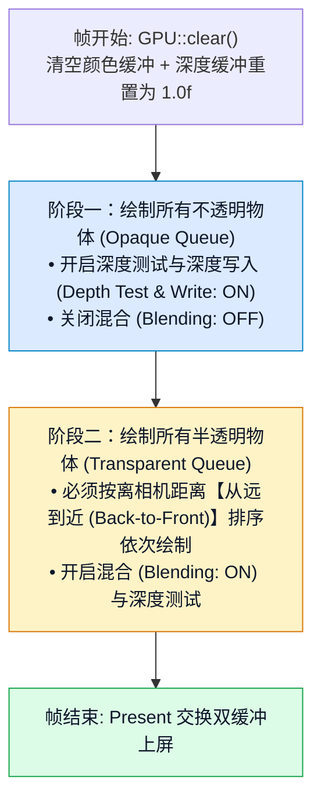

# Alpha 透明度混合与渲染队列次序

在 3D 渲染中，当场景中同时存在不透明物体（Opaque Objects，如墙壁、角色身体）与半透明物体（Transparent Objects，如玻璃窗、水流、烟雾特效）时，必须启用颜色混合（Blending）。由于半透明片元需要与背后的物体颜色进行线性叠加，深度测试（Depth Test）与透明度混合之间存在天然的机制冲突。

---

## 1. 颜色混合数学模型（`GPU::blend`）

当开启混合开关 `sgl->enable(BLENDING)` 后，通过深度测试的片元不会直接简单覆盖帧缓冲中的像素，而是执行线性插值加权：
- **源颜色（Source Color， $C_{\text{src}}$ ）**：当前片元着色器计算出的待写入颜色（含 Alpha 透明度通道）。
- **目标颜色（Destination Color， $C_{\text{dst}}$ ）**：当前帧缓冲中该像素位置已经存在的颜色。

### 1.1 标准 Alpha 混合公式
归一化透明度权重：

$$
\alpha = \frac{\text{src}.A}{255.0} \quad (\alpha \in [0.0, 1.0])
$$

合成公式：

$$
C_{\text{out}} = \text{lerp}(C_{\text{dst}}, C_{\text{src}}, \alpha) = (1 - \alpha) \cdot C_{\text{dst}} + \alpha \cdot C_{\text{src}}
$$

- 当 $\alpha = 1.0$ 时，完全不透明，输出纯源颜色；
- 当 $\alpha = 0.0$ 时，完全透明，输出原有底色；
- 当 $\alpha = 0.5$ 时，各占 50% 半透明透光。

---

## 2. 深度测试与半透明物体的冲突机制

深度测试（Z-Buffer）只关心物体的**空间遮挡几何关系**，不关心色彩或透明度：
- 当一个半透明物体离相机较近（例如近处的一块红色半透明玻璃，其深度值为 $0.3$ ）时，若它**先于其背后的不透明小球（深度值为 $0.7$ ）被绘制**：
  1. 半透明玻璃先光栅化，通过深度测试，此时深度缓冲对应像素被就地更新为较小的近处深度值 $0.3$ 。
  2. 随后绘制背景小球时，小球片元深度为 $0.7$ 。在深度测试中发现 $0.7 > 0.3$ ，系统会误认为小球被完全挡住，**从而直接将小球片元丢弃！**
  3. **最终视觉错误**：透过半透明玻璃，完全看不到背后的任何东西！

---

## 3. 标准透明渲染管线次序（Rendering Order）

为了解决上述冲突，商业游戏引擎（如 Unity、Unreal）与本项目均遵循严格的**两阶段渲染队列准则**：



### 3.1 实例 `15_blending` 的排序验证
在 `15_blending.cpp` 中定义了三个具有不同深度的三角形：
- `vao0`： $z = -0.8$ （最远处，不透明物体）
- `vao1`： $z = -0.5$ （中间层，半透明橙色 $\alpha = 0.5$ ）
- `vao2`： $z = 0.0$ （最近处，半透明红色 $\alpha = 0.5$ ）

代码演示了正确的绘制顺序：
```cpp
// 1. 不透明物体必须最先绘制
sgl->bindVertexArray(vao0);
sgl->drawElement(DRAW_TRIANGLES, 0, 3);

// 2. 半透明物体由远及近依次绘制
sgl->bindVertexArray(vao1); // 先画 z = -0.5
sgl->drawElement(DRAW_TRIANGLES, 0, 3);

sgl->bindVertexArray(vao2); // 后画 z = 0.0
sgl->drawElement(DRAW_TRIANGLES, 0, 3);
```
此时，每一层半透明片元在执行时，背景颜色都已经绘制在帧缓冲中，`GPU::blend` 能够层层取到正确的目标色 `dst` 进行透光混合，展现出层次分明的真实透光效果。
