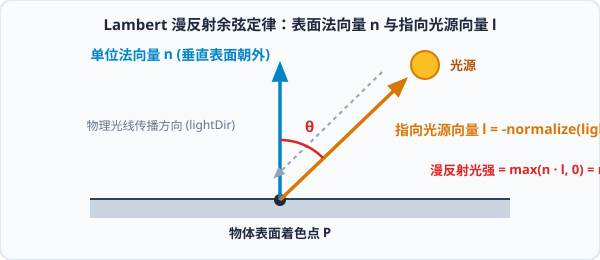

# 经典光照模型与 Lambert 漫反射着色

真实的物理世界中，物体由于受到光线的照射才呈现出明暗立体感与空间质感。在不引入实时光线追踪（Ray Tracing）的情况下，实时渲染使用局部经验光照模型模拟光子反射。本项目在 `LightShader` 中实现了一套经典的 **Lambert 漫反射 + 基础环境光** 逐像素光照管线。

---

## 1. 光照模型的三大组成部分（Phong / Blinn-Phong 思想）

在经典经验光照模型中，物体表面的最终光照颜色分解为三个独立项的叠加：

$$
I_{\text{total}} = I_{\text{ambient}} + I_{\text{diffuse}} + I_{\text{specular}}
$$

1. **环境光项（Ambient Light）**：模拟光线在场景中经过无数次漫反射后的间接光能底色，确保背光面不会呈现死黑。
2. **漫反射项（Diffuse Light）**：光线射向粗糙物体表面后向所有方向均匀散射的能量，产生明暗渐变。
3. **高光反射项（Specular Light）**：光滑表面朝视线方向产生的镜面高光反射斑点。

本项目重点实现并优化了漫反射项与环境光项的着色。

---

## 2. 朗伯余弦定律（Lambert's Cosine Law）

### 2.1 物理原理与向量定义

理想的漫反射表面（Lambertian Surface）具有微观粗糙结构。当一束平行光射向表面时：
- 光线垂直入射时，单位受光面积接收到的光通量密度最大；
- 随着光线斜射角度增大，受光面积被斜向拉长，单位面积分配到的光子变少，表面逐渐变暗；
- 接收到的辐射照度与表面法向量 $\mathbf{n}$ 与指向光源的向量 $\mathbf{l}$ 之间的夹角余弦成正比：

$$
I_{\text{diffuse}} \propto \cos\theta = \hat{\mathbf{n}} \cdot \hat{\mathbf{l}}
$$



#### 关键向量定义解析：
1. $\mathbf{n}$ **（Normal / 表面法向量）**：
   - **含义**：垂直于物体表面并指向外部的**单位向量**（模长 $|\mathbf{n}| = 1$ ）；
   - **作用**：精确描述当前待着色像素点所在的微观切面“朝向哪里”（如水平桌面法线朝上为 $(0, 1, 0)$ ，朝前的墙面法线为 $(0, 0, 1)$ ）。
2. $\mathbf{l}$ **（Light Direction / 指向光源的单位向量）**：
   - **含义**：**从物体表面着色点指向光源位置的单位向量**（模长 $|\mathbf{l}| = 1$ ）；
   - **⚠️ 核心易混淆点（直觉 vs 图形学）**：
     - 日常直觉认为光线是“从太阳照射到地面”（从上往下发射）；
     - 但在着色器公式中， $\mathbf{l}$ **必须取光线传播方向的反方向——即定义为“从表面指向太阳”**；
     - **数学原因**：只有当 $\mathbf{n}$ 和 $\mathbf{l}$ **均以物体表面着色点为公共起点向外发散**时，两个单位向量的点积才能准确计算出它们之间的夹角 $\theta$ 的余弦值：

$$
\mathbf{n} \cdot \mathbf{l} = |\mathbf{n}| |\mathbf{l}| \cos\theta = 1 \times 1 \times \cos\theta = \cos\theta
$$

### 2.2 夹角区间与 $\max(\mathbf{n} \cdot \mathbf{l}, 0)$ 的物理含义

根据点积结果 $\cos\theta$ ，表面受光呈现出三个关键物理区间：

| 夹角范围 | 点积数值 $\mathbf{n} \cdot \mathbf{l}$ | 光照状态 | 物理现象 |
| :--- | :--- | :--- | :--- |
| $\theta = 0^\circ$ **（垂直直射）** | $1.0$ **（最大值）** | **最亮** | 光线垂直照射表面，单位面积光子密度最高。 |
| $0^\circ < \theta < 90^\circ$ **（斜射）** | $(0.0, 1.0)$ | **明暗渐变** | 光束斜向铺展在更大面积上，亮度随余弦逐渐衰减。 |
| $\theta \ge 90^\circ$ **（背光背面）** | $\le 0.0$ **（负值）** | **无光照（阴影）** | 光线从物体背面射来，正面完全背光。必须截断为 0！ |

> **为什么要用 $\max(\mathbf{n} \cdot \mathbf{l}, 0)$ 截断？**
> 当物体背光时（ $\theta > 90^\circ$ ），数学点积会算出负数（如 $-0.8$ ）。若不进行截断，负数会直接抵消后续的环境光甚至产生反向负颜色（画面发黑坏死）。因此必须使用 $\max(\dots, 0.0f)$ 强制将负值截断为 0。

### 2.3 代码工程实现与方向修正
在代码 `LightShader.h` 中，平行光结构体定义为：
```cpp
struct DirectionalLight {
    math::vec3f color;
    math::vec3f direction; // 光线行进方向 (从光源指向物体表面)
};
```
在片元着色器执行时：
1. `mDirectionalLight.direction` 记录的是物理光线传播矢量（**从光源指向表面**，即 $-\mathbf{l}$ ）；
2. 为了得到正确的 $\mathbf{l}$ ，代码必须首先对其**取反并归一化**：

```cpp
   math::vec3f lightDir = math::normalize(-mDirectionalLight.direction); // 指向光源
```
3. 接着与经过插值并重新归一化的表面法线 `normal` 做点积，并施加边界安全截断：

```cpp
   float diffuse = math::dot(normal, lightDir);
   float diffuseFactor = std::clamp(diffuse, 0.0f, 1.0f); // 等价于 max(diffuse, 0.0f)
```

---

## 3. 着色流程（Gouraud 着色 vs Phong 着色）

| 着色技术 | 计算发生的阶段 | 特点 |
| :--- | :--- | :--- |
| **Gouraud 着色（逐顶点光照）** | 顶点着色器（Vertex Shader） | 仅在顶点计算光照，光栅化线性插值颜色。性能极高，但高光会被平滑拉伸消失，低多边形网格明暗突变生硬。 |
| **Phong 着色（逐片元光照，本项目采用）** | 片元着色器（Fragment Shader） | 顶点着色器仅变换法线；在光栅化后，**每个片元像素独立对法线归一化并执行光照公式**。明暗过渡丝滑细腻。 |

### 3.1 `LightShader::vertexShader` 阶段
顶点着色器仅负责将法线变换至世界空间（使用逆转置矩阵且齐次坐标 $w=0$ ）：
```cpp
output.mNormal = math::transpose(math::inverse(mModelMatrix)) * math::vec4f(normal, 0.0f);
```

### 3.2 `LightShader::fragmentShader` 阶段
1. **法线与光照重新归一化**：
   经过三角形重心插值后，单位法线的模长已小于 1，必须重新单位化：

```cpp
   auto normal = math::normalize(input.mNormal);
   auto lightDir = math::normalize(mDirectionalLight.direction);
```
2. **纹理漫反射颜色采样**：

```cpp
   math::vec4f texColor = texture->getColor(input.mUV.x, input.mUV.y);
```
3. **漫反射与环境光调制合成**：

```cpp
   // 漫反射光: 纹理色 * 漫反射系数 * 光源色
   float diffuse = std::clamp(math::dot(normal, -lightDir), 0.0f, 1.0f);
   math::vec4f diffuseColor = texColor * diffuse * math::vec4f(mDirectionalLight.color, 1.0f);

   // 环境光: 纹理色 * 环境光色
   math::vec4f envColor = math::vec3f(texColor) * mEnvLight;

   // 最终输出色彩
   output.mColor = vectorToRGBA(diffuseColor + envColor);
```

---

## 4. 立方体网格法线构造经验（为何是 36 个顶点？）

在 `18_light.cpp` 中定义了一个单位立方体。
几何学上立方体仅有 8 个顶点，但在渲染管线中：
- 同一个角点对于前面（ $+Z$ ）、顶面（ $+Y$ ）和右面（ $+X$ ）这三个面来说，**法线向量完全不同且相互正交**（分别为 $(0,0,1)$ 、 $(0,1,0)$ 、 $(1,0,0)$ ）。
- 如果强行让 8 个顶点共享索引，重心插值会把三个不同面的法线平均化为对角线方向，导致立方体看起来像一个光照圆滑的球体，棱角完全丢失（硬表面特征消失）。
- **因此硬表面几何体必须“拆点”**：立方体 6 个面，每个面由 2 个三角形共 6 个独立顶点组成，共计声明 **36 个互不共享法线的独立顶点**，确保每个面上的法向量严格垂直于该平面，展现出清晰分明的明暗硬边棱角。
