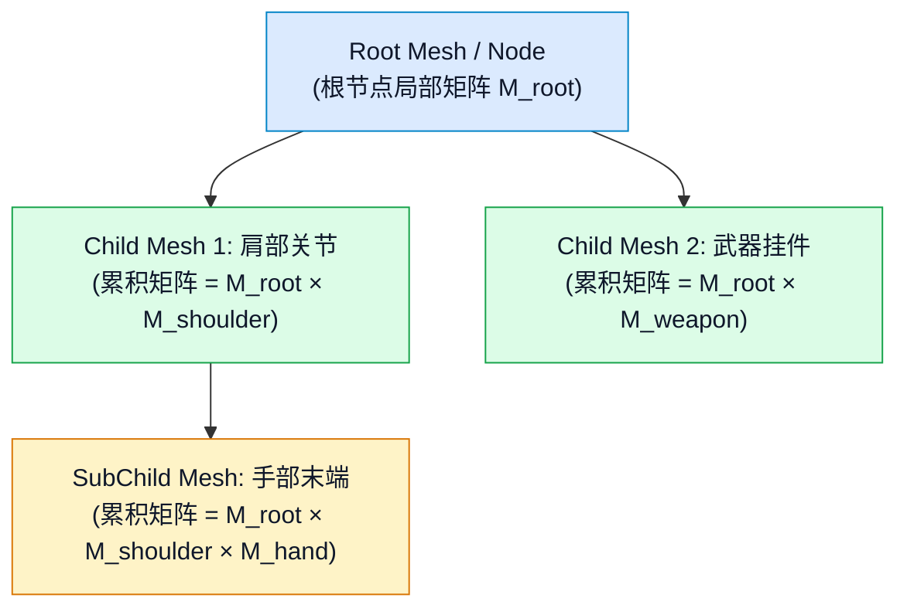

# Assimp 3D 模型加载与场景层级树

手工在代码中编写顶点数组只适用于简单的几何体（三角形、立方体）。在实际图形学工程中，复杂的 3D 资产（如恐龙、背包、角色）是由三维建模软件（Blender, Maya, 3ds Max）设计并导出为标准资产格式（`.obj`, `.gltf`, `.glb`, `.fbx`）。本项目集成业界标准开源库 **Assimp（Open Asset Import Library）**，构建了一套完整的树形多网格层级解析与渲染架构。

---

## 1. 宏污染与头文件包含顺序防范

在 `19_model.cpp` 顶部包含头文件时，存在一个极具工程代表性的 C++ 宏陷阱：
```cpp
// 必须先引入 model.h，再引入 application.h，避免 app 宏定义影响 assimp 库
#include "application/model.h"
#include "application/application.h"
```

### 1.1 产生原因
在 `application.h` 中为了调用简便，定义了一个全局宏：
```cpp
#define app Application::getInstance()
```
而 Assimp 内部的第三方模板库或参数中，存在名为 `app` 的成员变量或函数参数名（如 `aiApp` 或局部标识符）。
若先包含了 `application.h`，C++ 预处理器会无差别地将 Assimp 头文件中的所有 `app` 替换为 `Application::getInstance()`，导致极其晦涩难懂的编译语法报错。
**工程规约**：将外部复杂第三方库的封装头文件置于全局易污染宏头文件之前。

---

## 2. Assimp 资产导入后处理（Post-Processing）

调用 `importer.ReadFile(...)` 时，传入了三个关键的处理标志位：
```cpp
Assimp::Importer importer;
const aiScene* scene = importer.ReadFile(
    path,
    aiProcess_Triangulate | aiProcess_FlipUVs | aiProcess_GenNormals
);
```
1. **`aiProcess_Triangulate`（自动三角化）**：
   三维建模软件常导出四边形面片（Quads）甚至多边形（N-Gons）。该标志指示 Assimp 自动将其切分为标准的三角形图元。
2. **`aiProcess_FlipUVs`（翻转纹理 V 轴）**：
   模型贴图的 UV 原点习惯（如 DirectX 顶部为 0）可能与软光栅（底部为 0）不同，必要时由 Assimp 在载入时就地对 V 坐标取反。
3. **`aiProcess_GenNormals`（自动生成法线）**：
   对于缺失法线数据的轻量模型（如极简 `.obj`），Assimp 会依据面几何拓扑自动为每个顶点计算平滑的面法向量。

---

## 3. 场景图（Scene Graph）与层级矩阵变换传递

一个复杂的 3D 模型并不是一个单一的大网格，而是一棵以 `aiNode` 为骨架的**场景层级树（Scene Graph Tree）**：
- 父节点：可能是一个机械臂的肩膀；
- 子节点：肘关节、手指等部件；
- 每个节点包含自身的局部变换矩阵 `mTransformation`，以及挂载在该节点下的若干网格索引（`mMeshes`）。



### 3.1 矩阵格式转换（行主序 $\to$ 列主序）
Assimp 的 `aiMatrix4x4` 采用**行主序命名**（`a1~a4` 为第一行），而本项目的 `math::mat4f` 为**列主序内存**。
在 `Model::getMat4f` 中完成正确转置映射：
```cpp
math::mat4f to;
to.set(
    value.a1, value.a2, value.a3, value.a4,
    value.b1, value.b2, value.b3, value.b4,
    value.c1, value.c2, value.c3, value.c4,
    value.d1, value.d2, value.d3, value.d4
);
```

### 3.2 递归构建与层级矩阵累乘绘制（`Mesh::draw`）
在遍历解析时，为每个 `aiNode` 创建一个容器 `Mesh`，挂载其子 `Mesh`。
在每一帧执行 `draw` 时，从根节点递归向下传递父层级累積矩阵 `preMatrix`：
```cpp
void Mesh::draw(const math::mat4f preMatrix, LightShader* shader) {
    // 1. 复合父矩阵与本节点的局部矩阵
    auto modelMatrix = preMatrix * mLocalMatrix;

    // 2. 若当前 Mesh 包含实际几何顶点，则提交绘制
    if (mVao) {
        shader->mModelMatrix = modelMatrix;
        if (mTexture) {
            shader->mDiffuseTexture = mTexture;
        }

        sgl->bindVertexArray(mVao);
        sgl->bindBuffer(ELEMENT_ARRAY_BUFFER, mEbo);
        sgl->drawElement(DRAW_TRIANGLES, 0, mIndicesCount);
        sgl->bindVertexArray(0);
    }

    // 3. 将复合矩阵传递给所有子节点递归执行
    for (auto mesh : mChildren) {
        mesh->draw(modelMatrix, shader);
    }
}
```
通过层级累乘，移动或旋转根节点（`model->setModelMatrix(m)`），其下属所有成百上千个子部件、肢体与装备均会自动保持正确的相对位置同步运动。

---

## 4. 纹理缓存池与内嵌贴图（Embedded Texture）解码

3D 模型附带的材质贴图存在两种存储形态：

### 4.1 外部独立贴图
常见于 `.obj` 格式，贴图是单独存放在磁盘同一目录下的 `.jpg` 或 `.png` 文件。
拼接相对路径后调用 `Image::createImage(fullPath)` 加载。

### 4.2 内嵌二进制贴图（Embedded Texture）
在 `.glb`（二进制 glTF）或 `.fbx` 等高度整合的现代模型格式中，纹理图像被直接打包压缩嵌入在模型文件的二进制流内部。
- 调用 `scene->GetEmbeddedTexture(aiPath.C_Str())` 获取 `aiTexture*`。
- **关键判据**：当 `assimpTexture->mHeight == 0` 时，说明内嵌数据并非原始展开位图，而是**压缩的 JPG/PNG 字节流**，`mWidth` 此时代表字节流总长度！
- 代码通过 `stbi_load_from_memory` 直接从内存缓冲区展开解码为像素数组，无需落地为临时磁盘文件，极大加快了加载速度。

### 4.3 纹理缓存池查重（`mTextureCache`）
在一个复杂模型中，往往多个不同的部件网格共同引用同一张漫反射贴图（图集 Atlas）。
`Model` 内部维护贴图缓存映射表：
```cpp
std::map<std::string, uint32_t> mTextureCache;
```
每次加载贴图前先在缓存表中查找。若已加载过，直接复用已有的 GPU 纹理 ID，杜绝了重复的磁盘/内存读取、图片解码与显存开销。
