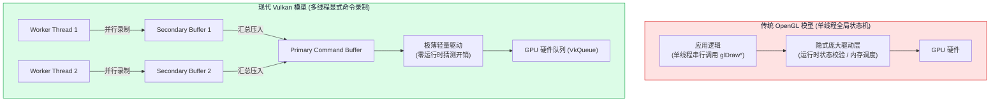
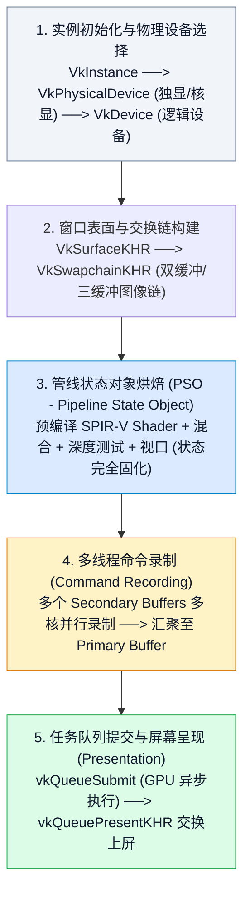

# 现代图形 API 架构演进与深度对比（OpenGL vs Vulkan）

本项目使用 C++ 纯手工实现了一套兼容现代 OpenGL（Core Profile）架构的可编程软光栅渲染器。然而在当今移动端与高性能 PC 图形开发中，底层的硬件驱动模型已发生了革命性变革。

为了让读者在掌握软光栅原理的基础上，站在更高的行业视角理解现代图形驱动的演化脉络，本文档系统梳理从 **OpenGL 全局状态机** 到 **Vulkan 显式底层驱动架构** 的设计哲学变革与核心机制。

---

## 1. 时代背景：传统图形 API 的架构瓶颈

### 1.1 OpenGL 的核心架构：全局状态机
OpenGL 设计于单核 CPU 时代（20 世纪 90 年代），其设计哲学是**基于隐式黑盒的单上下文状态机**：
- **全局单上下文（Context）**：整个应用程序或渲染线程共享一个唯一的渲染上下文，所有状态（绑定的着色器、VAO、混合模式、深度测试）均记录在驱动维护的一个庞大隐式结构体中；
- **难以支持多线程渲染**：几乎所有以 `gl` 开头的 API（如 `glBindBuffer`, `glUseProgram`）都是在原地修改当前线程上下文中的全局变量。如果多个 CPU 线程同时调用 OpenGL 命令，将引发灾难性的状态竞态破坏，因此 OpenGL 的 Draw Call 提交本质上必须是单线程串行的；
- **驱动负担沉重与不可控隐式行为**：显卡驱动程序扮演了“全知全能的保姆”。每次执行 `glDrawElements` 时，驱动都要做大量防御性状态合法性校验、动态显存分配、着色器即时重编译与管线状态重组。这导致驱动极为臃肿庞大，不同显卡厂商（NVIDIA、AMD、Intel）的行为常有细微差异，性能极难精准调优。

### 1.2 现代硬件的发展趋势
- **CPU 多核心普及**：8 核、16 核乃至更多核心的 CPU 成为标准，但传统 OpenGL 只能由主线程一个核心去提交绘图命令，其余核心在渲染瓶颈期只能空转；
- **GPU 算力爆发与流水线复杂化**：现代显卡拥有上万个并行计算流处理器，对显存访问带宽、计算与图形异步并发调度提出了极高要求。

这促使 Khronos 组织彻底重构图形 API，诞生了新一代工业界事实标准——**Vulkan**（同类架构还包括苹果的 Metal、微软的 DirectX 12）。

---

## 2. Vulkan 核心设计哲学：显式控制与零抽象开销

与 OpenGL 的“黑盒保姆”机制相反，Vulkan 奉行**显式控制（Explicit Control）**：**驱动不再替开发者做任何假设，一切状态、内存、依赖与同步全部由程序员在代码中显式声明和掌控。**

---

## 3. Vulkan 核心机制与经典比喻解析

### 3.1 资源与内存解耦：`VkImage` 与 `VkDeviceMemory`

在 OpenGL 中，调用 `glTexImage2D` 即可一步到位完成纹理创建与显存分配，开发者根本无法控制纹理究竟被存放在哪里。而在 Vulkan 中，**资源本身与物理显存被彻底解耦为两套独立的体系**：

#### 1. `VkImage`（资源逻辑描述句柄）
- 句柄在本质上是一个 64 位整数，指向内存中的逻辑对象；
- 它只定义了纹理的“规格属性”：长宽、通道格式、Mipmap 层级、平铺方式（Tiling）与用途掩码（采样纹理、深度附件还是颜色附件）；
- **注意**：创建 `VkImage` 时，显卡中**尚未分配任何物理显存**！

#### 2. `VkDeviceMemory`（物理显存块分配）
- 依据 `VkImage` 查询驱动所需的真实字节数（Size）与对齐要求（Alignment）；
- 遍历物理硬件，寻找合适的**内存类型索引（Memory Type Index）**：
  - **Host Visible（CPU 可见内存）**：位于系统内存或通过 PCI-E 映射，CPU 可以通过 `vkMapMemory` 映射指针并直接写入（如顶点缓冲的高频更新），但 GPU 读取较慢；
  - **Device Local（GPU 专用高速显存）**：通常位于板载 GDDR6/HBM 显存中，GPU 访问具备数百 GB/s 的超高带宽，但 CPU 无法直接寻址。
- 分配完毕后，通过 `vkBindImageMemory` 显式将物理显存块与 `VkImage` 控制句柄绑定。

#### 3. `VkImageView`（“相框”与“相片”的经典比喻）
- **VkImage 是“相片”**：代表纯粹的原始图像数据块；
- **VkImageView 是“相框”**：决定你“如何观察这张相片”。例如同一张多层纹理，你可以通过一个 ImageView 将其视为一个 2D 纹理，也可以通过另一个 ImageView 将其切片视为 Cubemap 的某一个单面，或者截取部分 Mipmap 级别。在着色器中绑定的永远是 ImageView，这使得资源的复用具备了极大的自由度。

---

## 4. 多线程利器：命令缓冲区（Command Buffer）机制

Vulkan 支持高帧率多线程渲染的杀手锏，在于彻底消除了即时调用（Immediate Mode），引入了**录制（Record）与提交（Submit）解耦**的命令队列架构。

### 4.1 主/次两级 Command Buffer 架构
- **Secondary Command Buffer（次级命令缓冲区）**：
  - 各个 CPU 工作线程（Worker Threads）可以在后台独立、并行地分配各自的 Secondary Command Buffer；
  - 每个线程并行录制属于自己的渲染批次（如：线程 1 录制静态地形绘制，线程 2 录制动态角色骨骼动画，线程 3 录制 UI）；
  - 这种“抓帧录制”过程完全规避了全局锁竞争，大幅跑满了多核 CPU。
- **Primary Command Buffer（主级命令缓冲区）**：
  - 主渲染线程只需创建一个 Primary Command Buffer；
  - 通过单条指令 `vkCmdExecuteCommands` 将所有录制完成的 Secondary Buffers 顺序压入主缓冲区；
  - 最终将 Primary Command Buffer 一次性提交到硬件任务队列（`VkQueue`）中。

---

## 5. Vulkan 渲染全生命周期流变环

---

## 6. OpenGL vs Vulkan 架构全方位对比

| 对比维度 | OpenGL（传统软光栅原型） | Vulkan（现代底层工业标准） |
| :--- | :--- | :--- |
| **状态机机制** | 全局唯一隐式状态机（Context） | 无全局状态，管线状态完全烘焙为不可变的 Pipeline 对象 |
| **多线程支持** | **原生不支持**（单线程绑定与调用） | **完全原生多线程**（Secondary Command Buffer 并行录制） |
| **内存控制** | 驱动在后台隐式分配与换页 | 显式分配 `VkDeviceMemory`，区分 Host Visible 与 Device Local |
| **着色器编译** | 运行时将 GLSL 文本字符串送交驱动编译 | 离线预编译为统一字节码（SPIR-V），驱动加载零延迟 |
| **错误检查** | 驱动在运行时每一帧进行防御性校验（开销大） | 运行时零校验；调试阶段通过开启独立的 **Validation Layers** 查错 |
| **开发复杂度** | 上手快，绘制一个三角形约数十行代码 | 极度繁琐严密，绘制一个三角形需 800~1000 行代码 |
| **性能上限** | 受限于 CPU 单核提交瓶颈与驱动不可控调度 | 榨干硬件性能极限，Draw Call 吞吐量高出数倍至数十倍 |

---

## 7. 软光栅读者的学习建议

本项目通过手写软光栅，完整还原了 OpenGL Core Profile 中的关键概念：`VAO`（顶点属性字典）、`VBO`（顶点内存缓冲）、`FrameBuffer`（颜色与深度缓冲区）以及 `Shader`（顶点/片元着色）。

这些概念是理解所有现代图形 API 的通用基石。当读者充分理解了软光栅中像素如何遍历、深度如何比对、矩阵如何连乘之后，再去学习 Vulkan 或 DirectX 12，便能清楚地洞悉那些复杂的 API 背后究竟在硬件底层调度什么资源，从而实现由“应用层调包”向“底层引擎架构师”的思维跃迁。
