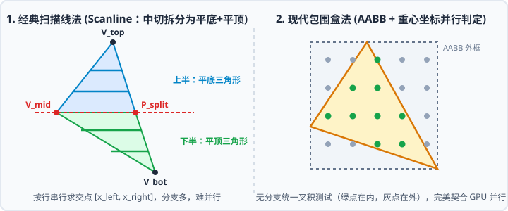

# 三角形光栅化与重心坐标插值算法

三角形是现代三维计算机图形学的核心几何基元（Primitive）。任意复杂的多边形均可三角剖分，且三角形必然共面、在仿射与透视投影下形状保持良好。本模块解析在屏幕空间中如何快速判断像素是否属于三角形，以及如何利用重心坐标完成顶点属性的高精度插值。

---

## 1. 轴对齐包围盒（AABB）遍历过滤

给定屏幕空间三角形三个顶点 $V_0, V_1, V_2$ ：
1. 计算三个顶点的最小/最大外包矩形边界：

$$
x_{\min} = \min(V_0.x, V_1.x, V_2.x), \quad x_{\max} = \max(V_0.x, V_1.x, V_2.x)
$$

$$
y_{\min} = \min(V_0.y, V_1.y, V_2.y), \quad y_{\max} = \max(V_0.y, V_1.y, V_2.y)
$$

2. 仅在包围盒范围内双重循环遍历像素点 $P(i, j)$ ，直接排除屏幕上绝大部分完全不相关的像素。

---

## 2. 2D 叉积内外测试（Point-In-Triangle Test）

对于待检测点 $P(i, j)$ ，构造从点 $P$ 指向三个顶点的向量：

$$
\mathbf{pv}_0 = V_0 - P, \quad \mathbf{pv}_1 = V_1 - P, \quad \mathbf{pv}_2 = V_2 - P
$$

计算相邻两向量的二维叉积（即两向量在平面上的有向面积）：

$$
c_0 = \mathbf{pv}_0 \times \mathbf{pv}_1 = (V_0.x - i)(V_1.y - j) - (V_0.y - j)(V_1.x - i)
$$

$$
c_1 = \mathbf{pv}_1 \times \mathbf{pv}_2 = (V_1.x - i)(V_2.y - j) - (V_1.y - j)(V_2.x - i)
$$

$$
c_2 = \mathbf{pv}_2 \times \mathbf{pv}_0 = (V_2.x - i)(V_0.y - j) - (V_2.y - j)(V_0.x - i)
$$

### 2.1 判据分析
- **同号判定**：
  若点 $P$ 在三角形内部，则向量 $\mathbf{pv}_0, \mathbf{pv}_1, \mathbf{pv}_2$ 的两两旋转方向必然一致：
  - 若三个顶点按逆时针排列，则 $c_0, c_1, c_2$ 必须全部大于等于 0；
  - 若三个顶点按顺时针排列，则 $c_0, c_1, c_2$ 必须全部小于等于 0。
  代码中综合判断：

```cpp
  bool negativeAll = (c0 <= 0 && c1 <= 0 && c2 <= 0);
  bool positiveAll = (c0 >= 0 && c1 >= 0 && c2 >= 0);
  if (negativeAll || positiveAll) {
      // 点 P 落在三角形内（含边缘）
  }
```

### 2.2 共享边缝隙防漏点规则
当两个三角形拼接为一个连续表面（如四边形面片）时，对角线上的边被两个三角形共享。
若在测试中采用严格的大于/小于（`c > 0` / `c < 0`），落在边上的像素点两边都不会被包含，拼接缝处会出现一排透明背景黑点（缝隙漏光）。允许包含等号（`<= 0` 与 `>= 0`）能保证边上的像素必然被光栅化覆盖。

---

## 3. 重心坐标系统（Barycentric Coordinates）

### 3.1 定义
三角形内部任意点 $P$ 均可唯一表示为三个顶点位置的线性加权和：

$$
P = \alpha V_0 + \beta V_1 + \gamma V_2
$$

其中加权系数 $(\alpha, \beta, \gamma)$ 称为点 $P$ 的重心坐标，满足归一化约束：

$$
\alpha + \beta + \gamma = 1 \quad (\alpha \ge 0, \beta \ge 0, \gamma \ge 0)
$$

### 3.2 面积坐标几何解释
重心坐标的几何意义正是面积比：
- 顶点 $V_0$ 对面的子三角形 $\triangle P V_1 V_2$ 面积占比决定了权重 $\alpha$ ：

$$
\alpha = \frac{S_{\triangle P V_1 V_2}}{S_{\triangle V_0 V_1 V_2}}
$$

- 类似地：

$$
\beta = \frac{S_{\triangle P V_0 V_2}}{S_{\triangle V_0 V_1 V_2}}, \qquad \gamma = \frac{S_{\triangle P V_0 V_1}}{S_{\triangle V_0 V_1 V_2}}
$$

- 当点 $P$ 恰好位于顶点 $V_0$ 时， $\alpha = 1, \beta = 0, \gamma = 0$ ；当点 $P$ 位于对边 $V_1 V_2$ 上时， $\alpha = 0$ 。

---

## 4. 光栅化单次叉积复用优化（`Raster::rasterizeTriangle1`）

在早期实现中，先做 3 次叉积判断点在三角形内，再调用专门的函数重复计算 3 次叉积求面积，这对于全屏数百万像素的软光栅是巨大的冗余计算。
在 `gpu/raster.cpp` 的优化版本中，将两步完全合并：

1. **包围盒外预计算总面积**：

$$
\mathbf{e}_1 = V_1 - V_0, \quad \mathbf{e}_2 = V_2 - V_0
$$

$$
\text{sumArea} = | \mathbf{e}_1 \times \mathbf{e}_2 | = 2 S_{\triangle}
$$

2. **像素循环内一次计算，双重复用**：
   计算出的 $c_0, c_1, c_2$ 不仅充当内外测试标志，其绝对值恰好就是各个子三角形面积的两倍：

$$
2 S_{\triangle P V_1 V_2} = |c_1|, \quad 2 S_{\triangle P V_0 V_2} = |c_2|, \quad 2 S_{\triangle P V_0 V_1} = |c_0|
$$

3. **直接求得重心权重**：

$$
\text{weight}_0 = \frac{|c_1|}{\text{sumArea}}, \quad \text{weight}_1 = \frac{|c_2|}{\text{sumArea}}, \quad \text{weight}_2 = \frac{|c_0|}{\text{sumArea}}
$$

4. **属性插值**：

$$
\text{Attr}(P) = \text{weight}_0 \cdot \text{Attr}_0 + \text{weight}_1 \cdot \text{Attr}_1 + \text{weight}_2 \cdot \text{Attr}_2
$$

   对 $1/w$ 、深度 $z$ 、颜色、法线、UV 同步进行插值，显著提升了软光栅执行帧率。

---

## 5. 代数求解视角：克拉默法则与向量点积法

除了几何面积比法外，重心坐标在代数上有两种严谨的解析解法：

### 5.1 克拉默法则（Cramer's Rule）
由重心坐标定义可建立关于 $(\alpha, \beta, \gamma)$ 的非齐次线性方程组：

$$
\begin{cases}
\alpha x_A + \beta x_B + \gamma x_C = x_P \\
\alpha y_A + \beta y_B + \gamma y_C = y_P \\
\alpha + \beta + \gamma = 1
\end{cases} \implies \begin{bmatrix}
x_A & x_B & x_C \\
y_A & y_B & y_C \\
1 & 1 & 1
\end{bmatrix} \begin{bmatrix}
\alpha \\
\beta \\
\gamma
\end{bmatrix} = \begin{bmatrix}
x_P \\
y_P \\
1
\end{bmatrix}
$$

设系数矩阵的行列式为 $D$ ：

$$
D = \det \begin{bmatrix}
x_A & x_B & x_C \\
y_A & y_B & y_C \\
1 & 1 & 1
\end{bmatrix}
$$

由克拉默法则，解可显式表达为将常数列替换对应列的行列式之商：

$$
\alpha = \frac{\det \begin{bmatrix}
x_P & x_B & x_C \\
y_P & y_B & y_C \\
1 & 1 & 1
\end{bmatrix}}{D}, \quad \beta = \frac{\det \begin{bmatrix}
x_A & x_P & x_C \\
y_A & y_P & y_C \\
1 & 1 & 1
\end{bmatrix}}{D}, \quad \gamma = \frac{\det \begin{bmatrix}
x_A & x_B & x_P \\
y_A & y_B & y_P \\
1 & 1 & 1
\end{bmatrix}}{D}
$$

各三阶行列式的展开形式与二维叉积面积公式完全同构。

### 5.2 向量点积投影法
设向量 $\mathbf{v}_0 = C - A, \mathbf{v}_1 = B - A, \mathbf{v}_2 = P - A$ 。寻找标量 $u, v$ 使得：

$$
\mathbf{v}_2 = u \mathbf{v}_0 + v \mathbf{v}_1
$$

两边分别点乘 $\mathbf{v}_0$ 与 $\mathbf{v}_1$ 建立二维线性方程组：

$$
\begin{bmatrix}
\mathbf{v}_0 \cdot \mathbf{v}_0 & \mathbf{v}_1 \cdot \mathbf{v}_0 \\
\mathbf{v}_0 \cdot \mathbf{v}_1 & \mathbf{v}_1 \cdot \mathbf{v}_1
\end{bmatrix} \begin{bmatrix}
u \\
v
\end{bmatrix} = \begin{bmatrix}
\mathbf{v}_2 \cdot \mathbf{v}_0 \\
\mathbf{v}_2 \cdot \mathbf{v}_1
\end{bmatrix}
$$

解出标量 $u, v$ 后，对应的重心坐标直接为：

$$
\alpha = 1 - u - v, \quad \beta = v, \quad \gamma = u
$$

点积法常用于光线追踪中的 Möller-Trumbore 射线/三角形求交算法。

---

## 6. 经典扫描线法（Scanline）vs 现代包围盒法（AABB）

在图形学演进史上，三角形光栅化经历了从早期的“CPU 扫描线几何切分”到现代“GPU 大规模并行包围盒测试”的技术路线变迁。



### 6.1 经典 CPU 扫描线光栅化原理（Scanline Algorithm）

早期单核 CPU 主频极低且无硬件并行单元，遍历包围盒内所有像素会浪费大量时间测试三角形外部的无效空白区域。因此，经典的软渲染器（如早期《雷神之锤》、DOS 时代 3D 引擎）普遍采用**扫描线（Scanline）算法**：

#### 1. 平底三角形（Flat-Bottom Triangle）
- **特征**：上顶点单一，底边两顶点拥有完全相同的纵坐标 $y_1 = y_2 < y_0$ ；
- **绘制过程**：
  - 循环以纵坐标 $y$ 为步长，从 $y_0$ 逐行递减（`y--`）至底边 $y_1$ ；
  - 针对每一行 $y$ ，分别计算当前扫描线与左腰、右腰两条直线的交点横坐标 $x_{\text{left}}$ 与 $x_{\text{right}}$ ；
  - 直接在 $[x_{\text{left}}, x_{\text{right}}]$ 区间内执行一条纯水平扫描线填充（Horizontal Span）。

#### 2. 平顶三角形（Flat-Top Triangle）
- **特征**：顶边两顶点纵坐标相同 $y_0 = y_1 > y_2$ ，底顶点单一；
- **绘制过程**：与平底三角形完全对称，以 $y$ 逐行递增绘制水平跨度。

#### 3. 任意普通三角形的“中切法”（Splitting Triangle）
对于任意倾斜的普通三角形（三个顶点高度各不相同 $y_{\text{top}} > y_{\text{mid}} > y_{\text{bot}}$ ）：
1. 在最长边（连接最高点与最低点的边）上，根据中间点高度 $y_{\text{mid}}$ 通过线性插值求出水平分割点 $P_{\text{split}}$ ：

$$
P_{\text{split}}.x = x_{\text{top}} + (x_{\text{bot}} - x_{\text{top}}) \cdot \frac{y_{\text{mid}} - y_{\text{top}}}{y_{\text{bot}} - y_{\text{top}}}
$$

2. 过 $y_{\text{mid}}$ 做一条水平分割线，将原三角形瞬间肢解为两部分：
   - 上半部分：由 $(\text{Top}, \text{Mid}, P_{\text{split}})$ 构成的**平底三角形**；
   - 下半部分：由 $(\text{Mid}, P_{\text{split}}, \text{Bot})$ 构成的**平顶三角形**；
3. 分别调用平底与平顶例程完成绘制。

### 6.2 现代 GPU 为何抛弃扫描线法，全面倒向 AABB 包围盒法？

| 对比维度 | 经典扫描线法（Scanline） | 现代包围盒法（AABB + 重心坐标） |
| :--- | :--- | :--- |
| **算法复杂度** | 高，包含大量点分类、求交、边排序与分支条件 | 极低，纯数学统一公式，代码结构高度紧凑规整 |
| **CPU 分支预测** | 差（频繁根据不同三角形形态走不同分支循环） | 优（只有统一的双重循环与纯无分支向量运算） |
| **硬件并行性** | **弱**：必须按行串行迭代，难以做大规模硬件并行 | **极强（SIMD / GPU 天作之合）**：每个像素独立测试 |
| **顶点属性插值** | 需沿两条边先做边插值，再沿扫描线做跨度插值（误差大） | 直接基于重心坐标点乘完成，数值精度高且易做透视校正 |
| **多采样抗锯齿** | 极难支持硬件 MSAA | 原生契合：包围盒内每个像素的 4 个采样点独立测试 |

**总结**：现代软光栅与 GPU 之所以选择 AABB 包围盒扫描，是以牺牲部分无效像素检测为代价，换取了**无分支逻辑、高度规整的数据流以及面向 SIMD / 多核向量化指令集的超高吞吐并行加速能力**。
