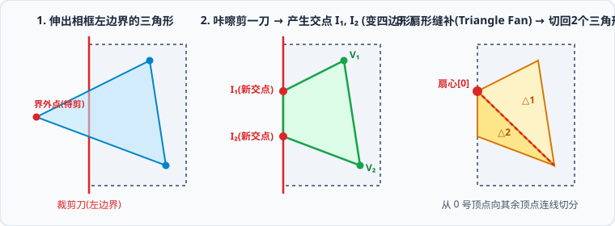
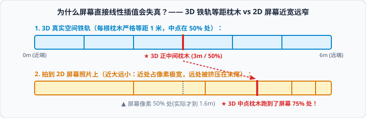

# Sutherland-Hodgman 视锥体裁剪与透视校正插值

在 3D 软光栅管线中，“视锥体裁剪”和“透视校正插值”往往是初学者最容易看蒙的两座大山。一个满是 4D 超平面不等式，另一个全是倒数 $\frac{1}{w}$ 的分式。

请先跳过数学公式，用下面两个生活中的**物理画面**，30 秒就能彻底搞懂它们到底在解决什么问题、是怎么干活的。

---

## 0. 30 秒核心直觉：相框剪纸与铁轨拍照

### 直觉一：什么是 Sutherland-Hodgman 裁剪？（拿剪刀沿相框剪纸片）
想象你手里拿着一个**长方形相框（屏幕视锥体）**，相框后面贴着一张**三角形纸片**，纸片有一个角伸出了相框左边界外面：
1. **为什么要剪掉它？**
   - 如果不剪，那个伸到屏幕外几万像素远的角，会让三角形的包围盒变得无比巨大，CPU 要去循环检测几亿个根本看不见的像素，程序瞬间卡死；更可怕的是，如果那个角伸到了**摄像机脑后（ $w \le 0$ ）**，透视除法除以负数会让图形在屏幕上发生诡异的“左右上下倒转折叠”！
2. **Sutherland-Hodgman 怎么剪？（流水线四刀切）**
   - 它就像一个极其死板但高效的流水线工人，手里拿着剪刀，**每次只贴着相框的一条边剪一刀**：
   - 第一刀沿**左边**剪 $\rightarrow$ 第二刀沿**右边**剪 $\rightarrow$ 第三刀沿**上边**剪 $\rightarrow$ 第四刀沿**下边**剪（3D 里还要加上近平面、远平面共 7 刀）。
   - **关键现象**：三角形被剪掉一个角后，断口处会多出两个交点，**三角形就变成了四边形（或五边形）**！
   - **最后一步（切披萨缝补）**：因为光栅化器只认识三角形，所以我们随便挑多边形的 **0 号顶点当圆心**，往其他顶点连线（像切披萨一样），把四边形重新切回 2 个标准三角形！



---

### 直觉二：什么是透视校正插值？（为什么站在铁轨上看枕木，间距不是均匀的？）
想象你站在一条笔直的铁轨中间，往远方拍了一张照片：
- **在真实 3D 世界里**：每根枕木之间的距离都是严格相等的 **1 米**。假设整段铁轨长 10 米，**正中间（第 5 米）**那根枕木上涂了红漆。
- **在拍出来的 2D 屏幕照片上**：因为**“近大远小”**，脚下第 1 米的枕木在照片上占了 **100 个像素**，而远处第 10 米的枕木只占 **2 个像素**！
- **灾难发生了**：现在光栅化器在 2D 屏幕上画到**照片正中间（50% 处）的像素**，如果它傻乎乎地直接按屏幕 50% 去取 3D 铁轨 50%（第 5 米）处的红漆，**那就全错位了！** 因为照片正中间的位置，实际上对应的是 3D 世界里离你很近的第 2 米处！



- **后果**：如果不做透视校正，直接用 2D 屏幕的重心坐标去插值 3D 的 UV 贴图坐标，贴在斜放地板上的格子图案就会像早年 PS1 游戏机一样，出现**严重的折线扭曲和画面游泳抖动**！
- **怎么解决？（数学家发现的神奇规律）**：
  虽然深度 $w$ 和属性 $I$ （如 UV）在屏幕上不是均匀变化的，但**把它们全都除以 $w$ 之后（即 $\frac{1}{w}$ 和 $\frac{I}{w}$ ），在 2D 屏幕上居然是严格均匀（线性）变化的！**
  于是就有了极其简单的**“透视校正三步曲”**：
  1. **出顶点着色器时（先压扁）**：把顶点的 UV、颜色全除以该顶点的 $w$ （算出 $\frac{I}{w}$ 和 $\frac{1}{w}$ ）。
  2. **屏幕光栅化时（正常插值）**：在 2D 屏幕上放心大胆地用重心坐标对 $\frac{I}{w}$ 和 $\frac{1}{w}$ 做普通线性插值。
  3. **进片元着色器前（再撑开）**：把插值出来的 $\overline{(\frac{I}{w})}$ 除以插值出来的 $\overline{(\frac{1}{w})}$ ，分母 $w$ 完美约掉，还原出 100% 真实的 3D 属性 $I$ ！

---

## 1. 齐次裁剪空间的 7 个裁剪平面（剪刀的 7 条边）

有了上面的直觉，我们看代码是怎么定义那“7 把剪刀”的。
裁剪必须发生在**透视除法（除以 $w$ ）之前**的 4D 齐次空间 $(x, y, z, w)$ 中（因为一旦先除以了负数或 0 的 $w$ ，坐标就已经毁了）。

未除以 $w$ 前，点在相框（视锥体）内部的条件是：

$$
-w \le x \le w, \quad -w \le y \le w, \quad -w \le z \le w, \quad w > 0
$$

移项把不等式右边都变成 $\ge 0$ （例如 $-w \le x \implies x + w \ge 0$ ），就能写成优雅的**四维向量点积** $\mathbf{P} \cdot \mathbf{Plane} \ge 0$ ：
```cpp
std::vector<math::vec4f> clipPlanes = {
    // 1. W > 0 边界（第一刀：先把摄像机脑后的点切掉）
    math::vec4f( 0.0f,  0.0f,  0.0f,  1.0f), // dot(P, Plane) = w >= 0
    // 2. Near 近平面 (-w <= z  ===>  z + w >= 0)
    math::vec4f( 0.0f,  0.0f,  1.0f,  1.0f),
    // 3. Far 远平面 (z <= w    ===> -z + w >= 0)
    math::vec4f( 0.0f,  0.0f, -1.0f,  1.0f),
    // 4. Left 左平面 (-w <= x  ===>  x + w >= 0)
    math::vec4f( 1.0f,  0.0f,  0.0f,  1.0f),
    // 5. Right 右平面 (x <= w  ===> -x + w >= 0)
    math::vec4f(-1.0f,  0.0f,  0.0f,  1.0f),
    // 6. Top 上平面 (y <= w    ===> -y + w >= 0)
    math::vec4f( 0.0f, -1.0f,  0.0f,  1.0f),
    // 7. Bottom 下平面 (-w <= y ===> y + w >= 0)
    math::vec4f( 0.0f,  1.0f,  0.0f,  1.0f)
};
```
- **判断点在界内还是界外**：只需算一次点积 $d = \mathbf{P} \cdot \mathbf{Plane}$ 。
  - $d \ge 0$ ：**在框内（保留）**；
  - $d < 0$ ：**在框外（要被剪掉）**。

---

## 2. Sutherland-Hodgman 逐刀裁剪与交点计算

对上面 7 个平面依次循环，每次用当前平面去裁剪多边形的每一条有向边（从起点 $S$ 走向终点 $P$ ）：


### 2.1 一条边跨过裁剪线时的 4 种情况

沿着多边形的边从起点 $S$ 走到终点 $P$ ，每步只决定**“往新列表里塞什么点”**：

| 起点 $S$ 位置 | 终点 $P$ 位置 | 状态描述 | 往新多边形列表里输出什么点？ |
| :---: | :---: | :--- | :--- |
| **框内** | **框内** | 整条边都在安全区内 | 输出终点 $P$ |
| **框内** | **框外** | 从框内穿出去了 | 终点 $P$ 不要了，只输出边与边框的**交点** $I$ |
| **框外** | **框内** | 从外面穿进安全区了 | 先输出边框**交点** $I$ ，再输出安全区内的终点 $P$ |
| **框外** | **框外** | 整条边都在框外 | **什么都不输出**（整段扔掉） |

### 2.2 交点 $I$ 怎么算？（按离边框的距离比例插值）
当一条边跨越边框（一头在里 $d_S > 0$ ，一头在外 $d_P < 0$ ）时，交点 $I$ 在哪里？
就像相似三角形分线段一样，直接用两点到边框的距离占总距离的比例求出权重 $t$ ：

$$
t = \frac{d_S}{d_S - d_P} \quad (t \in [0, 1])
$$

（因为 $d_S$ 和 $d_P$ 一正一负，分母 $d_S - d_P$ 其实就是两段绝对距离之和 $|d_S| + |d_P|$ ！）
拿到比例 $t$ 后，用线性插值 `lerp(S, P, t)` 就能算出交点 $I$ 的坐标、颜色、法线和 UV。

### 2.3 扇形三角剖分（切披萨缝补）
7 刀切完后，如果剩下的顶点列表 `results` 有 $N$ 个顶点（ $N \ge 3$ ），以 `results[0]` 为公共圆心，每相邻两个顶点切成一个三角形（共切出 $N - 2$ 个三角形）：
```cpp
for (uint32_t c = 0; c < results.size() - 2; c++) {
    outputs.push_back(results[0]);     // 披萨圆心 V0
    outputs.push_back(results[c + 1]); // 边缘点 1
    outputs.push_back(results[c + 2]); // 边缘点 2
}
```

---

## 3. 透视校正插值的代码落地（三步曲对照）

对应第 0 节的“铁轨枕木直觉”，软光栅代码只需在三个阶段各写几行代码即可彻底消灭透视畸变：

### 第一步：透视除法时——“先全部除以 $w$ 压扁”（`GPU::perspectiveDivision`）
```cpp
// 1. 先存好 1/w
vsOutput.mOneOverW = 1.0f / vsOutput.mPosition.w;

// 2. 把所有需要插值的顶点属性提前乘以 1/w（即 I / w）
vsOutput.mColor  *= vsOutput.mOneOverW;
vsOutput.mNormal *= vsOutput.mOneOverW;
vsOutput.mUV     *= vsOutput.mOneOverW;
```

### 第二步：屏幕光栅化时——“对 $\frac{I}{w}$ 和 $\frac{1}{w}$ 做普通屏幕重心插值”（`Raster::rasterizeTriangle1`）
在 2D 屏幕上求出重心坐标 $(\alpha, \beta, \gamma)$ 后，像平时一样线性加权：

$$
\overline{\left(\frac{1}{w}\right)} = \alpha \frac{1}{w_0} + \beta \frac{1}{w_1} + \gamma \frac{1}{w_2}
$$

$$
\overline{\left(\frac{I}{w}\right)} = \alpha \frac{I_0}{w_0} + \beta \frac{I_1}{w_1} + \gamma \frac{I_2}{w_2}
$$

### 第三步：进片元着色器前——“除以 $\frac{1}{w}$ 撑开还原”（`GPU::perspectiveRecover`）
```cpp
// 把插值出来的 (I/w) 除以插值出来的 (1/w)，即乘以 w，还原出真实的 3D 属性 I！
fsInput.mColor  /= fsInput.mOneOverW;
fsInput.mNormal /= fsInput.mOneOverW;
fsInput.mUV     /= fsInput.mOneOverW;
```

---

## 4. 进阶附录：为什么 $\frac{1}{w}$ 和 $\frac{I}{w}$ 在屏幕上是线性的？（数学证明，初学可跳过）

> [!NOTE]
> 如果你只关心怎么写代码，看懂上面第 3 节的三步曲就完全够用了。本节供希望探究底层代数证明的读者查阅。

1. 设 3D 观察空间中一条线段的参数方程为（ $s \in [0, 1]$ 为 3D 真实线性比例）：

$$
X(s) = X_0 + s \Delta X, \quad Z(s) = Z_0 + s \Delta Z
$$

   线段上的属性（如纹理坐标 $I$ ）随 3D 距离均匀变化：

$$
I(s) = I_0 + s \Delta I
$$

2. 经过透视投影后，齐次分量 $w = -Z$ ，屏幕横坐标 $x$ 与 $\frac{X}{w}$ 成正比。
3. 考察屏幕空间插值比例 $t_{\text{screen}} \in [0, 1]$ 与 3D 真实比例 $s$ 的关系，由投影几何消去参数 $s$ 后可得：

$$
\frac{1}{w(x)} = (1 - t_{\text{screen}}) \frac{1}{w_0} + t_{\text{screen}} \frac{1}{w_1}
$$

$$
\frac{I(x)}{w(x)} = (1 - t_{\text{screen}}) \frac{I_0}{w_0} + t_{\text{screen}} \frac{I_1}{w_1}
$$

4. 这两个恒等式在数学上严格证明了：**深度倒数 $\frac{1}{w}$ 与预除属性 $\frac{I}{w}$ 都是屏幕坐标 $x$ 的一次线性函数**，因此唯有对它们做屏幕空间重心插值才是物理精确的。
